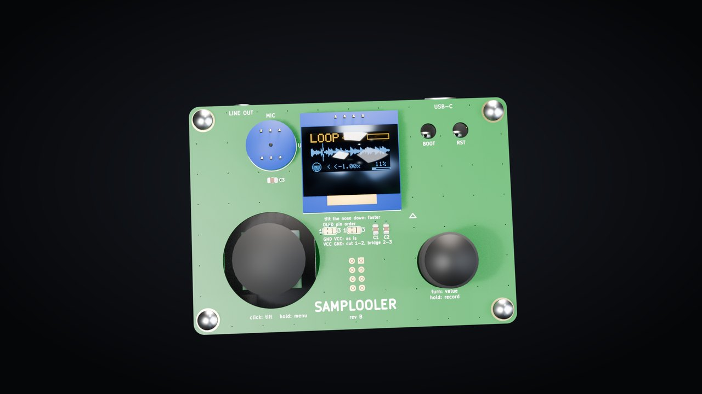

# Samplooler

[](https://github.com/willbearfruits/samplooler/actions/workflows/build.yml)

A small looper you play by tilting it. Hold the button and make a sound; let go and it loops. Tip
the box forward and the loop runs faster, tip it back and it runs backwards, roll it sideways for a
tape delay or a stutter.



**Project page and browser flasher:** https://willbearfruits.github.io/samplooler/  
**A 90-second tour with sound:** [on the project page](https://willbearfruits.github.io/samplooler/#video)
(the file is [hardware/images/samplooler-showcase-full.mp4](hardware/images/samplooler-showcase-full.mp4)).
It is rendered, not filmed: the sound is the firmware's own playback engine running on a computer.

## Status

Early. The firmware builds for both chips on every push. The circuit boards pass their electrical
and design-rule checks but have not been made yet, and the C3 case has not been printed, so expect
a round of fixes once real parts arrive. Reports of builds, good or bad, are welcome in the issues.

## Two versions

| | S3 | C3 mini |
| - | - | - |
| Board | ESP32-S3 SuperMini | ESP32-C3 SuperMini with a 0.42" OLED, or the plain one |
| Take | 20 s at 32 kHz | about 5 to 7 s at 16 kHz |
| Modes | tape (speed and pitch together) and grain (apart) | tape |
| Roll effects | tape delay, stutter | none |
| Screen | 0.96" 128 × 64 OLED | the board's 0.42" 72 × 40 OLED |
| Controls | encoder, joystick, record button | record button, optional encoder |
| With a computer | USB MIDI and sound card, VST3 plugin | none |
| Parts, roughly | $15 to $25 | $10 to $17 |

Both need an INMP441 microphone, a PCM5102A line-out module and an MPU-6050 tilt sensor.

## Build one

- **Flash** it from the [project page](https://willbearfruits.github.io/samplooler/) in Chrome or
  Edge. [docs/BUILD.md](docs/BUILD.md) also covers esptool and building from source.
- **Wire** it: [docs/BUILD.md](docs/BUILD.md) has the parts, the pin tables, the DAC straps and a
  first power-on check. The S3 version uses the pins of the
  [ESP32-S3 SuperMini kit](https://github.com/willbearfruits/esp32-s3-supermini-kit).
- **Circuit boards** for the S3, a two-board stack or a one-board Mini: [hardware/](hardware/).
- **Case** for the C3: [enclosure/](enclosure/), one OpenSCAD file.

## From source

The firmware is one ESP-IDF 5.5 project for both chips:

```sh
cd firmware
idf.py set-target esp32s3 && idf.py build flash monitor                  # S3
idf.py -B build-c3 -DSDKCONFIG=sdkconfig.c3 set-target esp32c3          # C3, once
idf.py -B build-c3 -DSDKCONFIG=sdkconfig.c3 build flash monitor
```

| Path | What |
| - | - |
| `firmware/` | the ESP-IDF project; `main/pins.h` holds the pins for both chips |
| `plugin/` | JUCE plugin, VST3 and standalone: mirrors the S3's settings over MIDI and shows its log |
| `site/` | the project page: browser flasher and an in-browser demo of the playback engine |
| `hardware/` | the circuit boards, generated from Python in `hardware/gen/` |
| `enclosure/` | the C3 case |
| `tools/` | `sl_midi.py` (log and MIDI from a shell), `flash.sh`, `release.sh`, `uisim/` (the screens rendered on a computer), `showcase/` (the video) |
| `docs/` | the build guide, the design note, enclosure notes, the pin map |

## Licence

- Firmware, tools and the board generator: GPL-3.0 ([LICENSE](LICENSE)).
- Plugin: AGPL-3.0, as JUCE requires ([plugin/LICENSE](plugin/LICENSE)).
- Case, circuit boards, docs and images: CC BY-SA 4.0 ([enclosure/LICENSE](enclosure/LICENSE),
  [hardware/LICENSE](hardware/LICENSE)).

Made in Haifa by Serious S.H.I.T.
