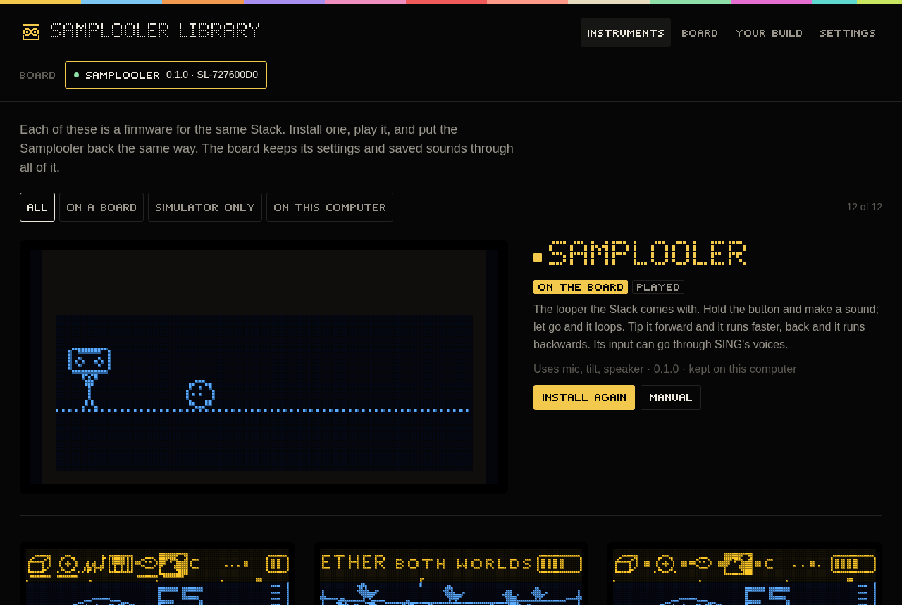

# Samplooler Library

A small desktop app for the Stack: the list of instruments, one button to put any of them on a board over USB,
and the Samplooler back the same way. It also shows each instrument's README and manual, a running board's
settings and log, and installs a build of your own.



## What it does

- Lists the Samplooler and the eleven instruments from the project page (or a folder on this computer), with
  their screens, status, README and manual. What it downloads it keeps, so a firmware installs again without
  a connection.
- Finds the boards plugged in: one running any of these firmwares shows up by its MIDI port's name; one in
  download mode (BOOT held while plugging in) shows up as Espressif's serial port.
- Installs with one click: asks the board over its own MIDI port to restart into download mode
  (SysEx `F0 7D 52 F7`), checks the MAC on the serial port that appears is the board that was asked, writes
  the bootloader, the partition table and the program (the NVS with the settings and the Samplooler's sample
  slots are not touched: the same two-part write as `tools/flash.sh`), restarts it and waits for it to come
  back. A board that is not one of ours, a TWOFOLD among them, is never opened or written. A board already in
  download mode is written only when it is the only one.
- Your build: pick an instrument's folder (or its `firmware/` or `build/`) and install what `flash_args` lists.
- A board's settings and log, for firmwares that describe their settings over MIDI (protocol 1); every
  firmware's log works.

## Build and run

Rust (stable) and Tauri 2's requirements for your platform (on Linux: webkit2gtk 4.1, gtk 3, libsoup 3;
`cargo install tauri-cli --locked` is optional, plain cargo builds it too):

```sh
cd app/src-tauri
cargo build --release              # target/release/samplooler-library
cargo tauri build                  # with the tauri CLI: also the deb / AppImage / rpm bundles
```

Run `target/release/samplooler-library`. It reads the library from the project page by default. For a local
copy, build one from this checkout and point the app at it (Settings > Library > A folder does the same):

```sh
python3 tools/library.py site --local --out /tmp/site      # from the repository's root, after idf.py build
SAMPLOOLER_LIBRARY=/tmp/site app/src-tauri/target/release/samplooler-library
```

On the command line, without a window: `--boards` lists the boards, `--check` restarts a board into download
mode, reads its MAC and restarts it without writing anything.

## Working on the window

`ui/` is plain HTML, CSS and JS (no build step). Opened in a browser it runs against `tools/mock.js`, a
stand-in for the Rust side, with a library folder served next to it; `tools/shots.sh` takes the screenshots in
`screenshots/` that way (needs Chromium). `tools/fonts.py` exports the firmware's pixel fonts to `ui/fonts.js`,
`tools/icon.py` draws the icon.

## Status

Built and run on Linux against a local library. Not yet used to flash a real board from the app (the flashing
code is the espflash crate, with the same rules as `tools/flash.sh`); not built on Windows or macOS yet.
