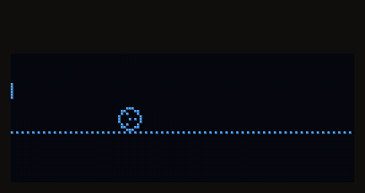
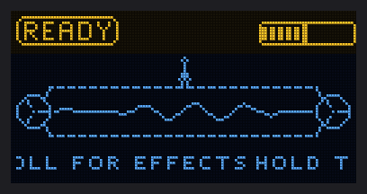
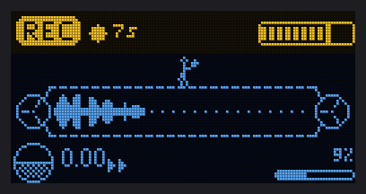
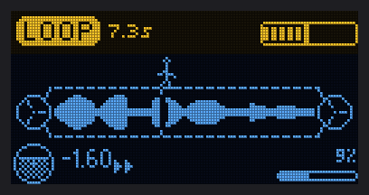
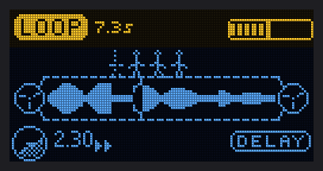
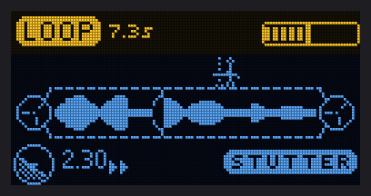
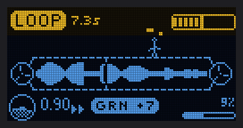
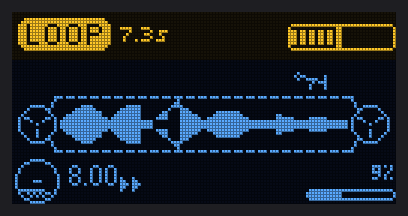
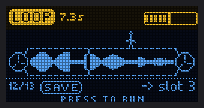
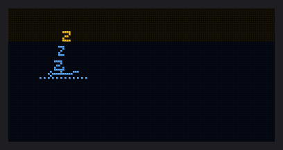

# Samplooler manual

Hold the button and make a sound. Let go and it loops. Tilt the box and the loop follows your hand.

This manual is for the Samplooler firmware 0.1 on the Stack, the two-board ESP32-S3 version. Building one is in
[BUILD.md](BUILD.md).

A Stack bought ready-made comes loaded with the Samplooler. The other instruments in
[instruments/](../instruments/) flash onto the same boards, and the Samplooler flashes back the same way.



## What it does

A looper with no buttons to learn. One button records. The angle of the box is the only other control you need.

| | |
| - | - |
| Hold | Hold the record button and talk, sing, beatbox, or hold it to a speaker. Up to 20 seconds. The screen fills a tape as you go. |
| Let go | It loops. The operator on the screen runs along the tape at the real speed and direction. Flat on the table the loop crawls, so the sound never quite stops. |
| Tilt | Nose down plays forward, faster the further you tip. Nose up plays backwards. Roll it to the left for a delay, to the right for a stutter. |

Everything it can do:

| | |
| - | - |
| Record | 20 seconds at 32 kHz from the built-in microphone, or from the computer over USB (Input = USB). |
| Voice | Optional: 18 voices on the input before it is recorded: autotune, harmonies, a choir, a vocoder, pitch and throat shift, echo and reverb. Off by default. See The voice below. |
| Play | Tilt sets the speed from a crawl to 8x, forward or backwards. Speed max and Speed min are settings. Snap rounds the speed to octaves and fifths. |
| TAPE mode | Pitch follows speed, like a tape machine. The default. |
| GRAIN mode | Speed and pitch come apart: the loop plays in grains, and Pitch shifts it up to two octaves either way at any speed. The operator juggles. |
| Roll effects | Roll the box left for a delay, right for a stutter. Hold the angle to keep them, roll back to flat to let them go. |
| Freeze | Hold the encoder and the speed, direction and effects stay where they are while you move the box. |
| Slots | Eight loops saved on the board itself. They survive power cycles and firmware updates. |
| USB | To a computer it is a MIDI device and a stereo sound card at once. Every setting is a MIDI CC, so a DAW or the plugin can automate it, and the loop comes out as audio. |
| Screen | A tape between two reels with the loop's shape on it, and the operator running on top. |

## Playing it

The nose is the edge with the USB-C and the line out. The record button is the joystick: press the stick down and
hold it. The knob is the encoder.

> PHOTO: the Stack held in two hands, nose away from the player, a thumb on the stick, the knob on the right

> PHOTO: the nose up close: the line out jack and the USB-C

> VIDEO: record a word, then nose down, nose up, roll left, roll right, with the sound, about 30 s

| Control | While playing | In the menu | Editing a setting |
| - | - | - | - |
| Stick, held down | record | record | record |
| Encoder tap | open the menu | edit the setting, or run Save / Load | back to the list |
| Encoder turn | adjust the last setting (a toast shows it) | choose a setting | adjust it |
| Encoder hold 0.5 s | freeze the tilt: speed, direction and the roll effects stay where they are, HOLD on the screen. Hold again to release. | leave the menu | leave the menu |

| Move | What happens |
| - | - |
| Nose down | Forward, faster with the angle. Speed max at 45 degrees. |
| Nose up | Backwards, faster with the angle. |
| Flat, within 5 degrees | The crawl: Speed min, 0.05x by default. Nothing stops. |
| Roll left, past 15 degrees | Delay: 380 ms echoes, louder and longer the further you roll. |
| Roll right, past 15 degrees | Stutter: a slice of the loop repeats, shorter the further you roll (260 ms down to 12 ms). |

BOOT, under the small hole next to the screen, also records while you hold it.

Rev C boards have older hints printed next to the screen ("stick click: tilt, hold: menu", "knob hold:
record"). The firmware no longer works that way. Go by the tables above.

Freeze: found a speed and a direction you like? Hold the encoder half a second. The tilt reading is latched, HOLD
appears next to the speed, and you can put the box down or wave it about. Hold again to let it follow your hand.
Recording, the menu and the slots all keep working while frozen.

Tip: keep recordings short and the loop clean, and let go on a beat. The loop seam is click-free, so a tight loop
turns into a rhythm by itself. Tilt a little, not a lot; the interesting speeds are between 0.5x and 2x.

To empty the tape, tap the stick. A recording shorter than about a tenth of a second does not loop: the old loop is
gone and it goes quiet.

Watch the operator. It runs at the real speed and direction, tumbles above 4.5x (with Speed max set above that),
is echoed by the delay, doubles with the stutter and juggles in GRAIN. Below 0.08x, which includes the default
crawl, it stands still and taps its foot.

|  |  |  |
| - | - | - |
| ready | recording | nose up: backwards |
|  |  |  |
| rolled left: delay | rolled right: stutter | GRAIN: juggling |
|  |  |  |
| above 4.5x: flung | menu: save to a slot | no loop, left alone: asleep |

## The voice

The input can go through a voice before the Samplooler records it: the voice processor of the SING firmware
(`instruments/sing`). Set Voice in the menu (OFF is the Samplooler as it always was). Key and Scale set the notes
the tuning lands on and the harmonies use; the harmonies and the vocoder play the key's first chord. The echo's
time follows the loop (the loop counts as one bar of four beats).

| Voice | |
| - | - |
| CLEAN | your voice, evened out, a little echo and room |
| NATURAL TUNE | a gentle pull to the nearest note in the key |
| HARD TUNE | the hard robot step to the note |
| CHOIR | a choir singing with you |
| BARBERSHOP | three harmonies on the chord |
| THIRDS | a third above you, in the key |
| OCTAVE DOWN | an octave under you |
| ROBOT | a vocoder playing the note you sing, tuned |
| VOCODER | your voice playing the chord |
| TALKBOX | a buzzy vocoder on the chord and your note |
| WHISPER | the vocoder on noise |
| CHIPMUNK, MONSTER, BIG THROAT | pitch and throat (formant) shifted |
| SPACE ECHO, CATHEDRAL, SHIMMER, DUB VOICE | echo and reverb, long |

Monitor: WHILE REC (the default) plays the input only while you record, as the Samplooler always did. ALWAYS
plays it all the time, so you can sing through the voice over the loop. The speaker sits next to the mic: with
Monitor ALWAYS, use headphones or the line out, or turn Speaker off.

The voice takes CPU (the menu's bottom strip shows it): about a third of it more for most voices, more with the
vocoder ones. Not yet measured on a board.

## The menu and the settings

Tap the encoder to open the menu, turn to choose, tap to edit, turn to adjust, tap to go back, hold half a second to
leave. Outside the menu a turn adjusts whatever you chose last, with a toast on the screen. If that was Save or
Load, a turn to the right runs it again.

| Setting | Range | Step | Default | What it does |
| - | - | - | - | - |
| Mic gain | 0 to 36 dB | 1 dB | 12 dB | Input level. A block at the right end of the input meter means it clipped: turn it down. |
| Mode | TAPE, GRAIN | | TAPE | TAPE: pitch follows speed. GRAIN: speed and pitch are independent. |
| Pitch | -24 to +24 | 1 | 0 | Semitones, GRAIN only. In TAPE it reads "= speed". |
| Tilt | on, off | | on | Off: plays forward at Speed max, whatever the angle. |
| Speed max | 0.25x to 8x | 0.25x | 2x | The speed at 45 degrees. Above 2x the recording aliases audibly, which may be what you want. |
| Speed min | 0 to 1x | 0.05x | 0.05x | The crawl when flat. 0 freezes the tape. |
| Snap | on, off | | off | Speeds rounded to octaves and fifths between 0.25x and 8x: a tuned instrument. |
| Grain | 20 to 200 ms | 10 ms | 50 ms | Grain length, GRAIN only. Short is smooth, long is choppy. |
| Volume | 0 to 150 % | 5 % | 100 % | Output level. Above 100 % can clip. |
| Input | mic, USB | | mic | USB records what the computer plays into the sound card. |
| Voice | OFF and 18 voices | | OFF | The voice on the input (see The voice). |
| Key | C to B | | C | The key the voice tunes to. |
| Scale | MAJOR, MINOR, DORIAN, MIXOLYDIAN, PHRYGIAN, HARM MINOR | | MAJOR | The notes of the key. |
| Monitor | WHILE REC, ALWAYS | | WHILE REC | When the input (the voice) is heard. |
| Slot | 1 to 8 | | 1 | The slot that Save and Load use. The menu shows its length, or "empty". |
| Save | | | | Writes the loop to the slot. The sound fades out, a bar runs under SAVING, then SAVED, and the loop fades back in. A few seconds, more for a long loop. |
| Load | | | | Reads the slot back. Same fade. Recording is ignored while a save or load runs. |
| Speaker | on, off | | on | Off silences the speaker amp; the line out and USB keep playing. For when the speaker feeds back into the mic. Not on MIDI. |

Settings stay on the board. A change is written 3 seconds after the last one when no loop is playing, and 30
seconds after it while a loop plays. Never while recording.

## Keeping it safe

It cannot be bricked, and it can always be put back to how it came.

| | |
| - | - |
| Factory reset | Hold the stick down while plugging in and keep it down. The screen counts "RESET? hold REC" 3, 2, 1, then restores the default settings. Let go earlier and nothing happens. The saved loops stay. |
| Safe mode | Three crashes in a row and the next boot starts from the default settings and keeps them, so a bad value can never lock you out. Ten seconds of normal running clears the count, and so does unplugging it. |
| Recovery | Whatever the firmware does, the chip's own download mode is reachable: hold BOOT, tap RST (or plug in with BOOT held), release BOOT. The flasher then sees the board. |
| Console mode | Hold the encoder down while plugging in and the board keeps its plain serial console. USB MIDI and the sound card stay off; the looper and the line out still work. That is for developers. If the computer sees no Samplooler port, plug in again without touching anything. |

| Built in | What it does for you |
| - | - |
| Watchdog | A hang in the controls or the audio resets the device within five seconds instead of leaving it stuck. |
| Range checks | Settings read from flash are clamped to what the menu allows, whatever version wrote them. |
| Safe saves | A loop is written to a temporary file and renamed at the end, so a power cut mid-save never leaves a half slot. |
| Self-healing storage | Corrupt settings storage is re-formatted on boot. A slot filesystem that will not mount is re-formatted: the loops are lost, the device is not. |
| Quiet start | The optional speaker amp is held off until the audio clock has run clean for 50 ms, so power-up does not thump. |
| Screensaver | With no loop and three minutes without a touch, the screen drifts to a sleeping operator, so the OLED does not burn in. Any control wakes it. |

## With a computer

Plugged into a computer it is a class-compliant MIDI device and a stereo sound card, no driver needed. Both are
called Samplooler. The loop comes out of the sound card; what the computer plays into it can be the recording
source (Input = USB). The line out keeps playing.

### MIDI in

Any channel.

| Message | What it does |
| - | - |
| CC 20 to 34 | Sets a setting, see below. |
| Program change | Picks the voice: 0 is OFF, 1 to 18 the voices in the order above. |
| Note 60 | Record while held. |
| Note 61 | Load the current slot. |
| Note 63 | Save to the current slot. |
| Note 64 | Freeze or release the tilt, like holding the encoder. |
| SysEx `F0 7D 53 F7` | Log the status line and the last crash report. |
| SysEx `F0 7D 52 F7` | Reboot into download mode, for flashing without BOOT. |

| CC | Setting | 0 to 127 means |
| - | - | - |
| 20 | Mic gain | 0 to 36 dB |
| 21 | Mode | below 64 TAPE, 64 and up GRAIN |
| 22 | Pitch | 64 is 0, two steps per semitone: 16 is -24, 112 is +24 |
| 23 | Tilt | below 64 off, 64 and up on |
| 24 | Speed max | 0.25x to 8x |
| 25 | Speed min | 0 to 1x |
| 26 | Snap | below 64 off, 64 and up on |
| 27 | Grain | 20 to 200 ms |
| 28 | Volume | 0 to 150 % |
| 29 | Input | below 64 mic, 64 and up USB |
| 30 | Voice | 0 is OFF, then about 7 per voice (127 is DUB VOICE) |
| 31 | Key | about 11.5 per key: 0 is C, 127 is B |
| 32 | Scale | about 25 per scale: 0 is MAJOR, 127 is HARM MINOR |
| 33 | Monitor | below 64 WHILE REC, 64 and up ALWAYS |
| 34 | Slot | 16 per slot: 0 to 15 is slot 1, 112 to 127 is slot 8 |

### MIDI out

Channel 1. The CCs are sent when they change.

| Message | What it carries |
| - | - |
| CC 1 | Pitch angle, 64 is flat |
| CC 2 | Roll angle, 64 is flat |
| CC 3 | Speed, 64 is stopped |
| CC 4 | Loop position |
| CC 5, 6 | Joystick X and Y. They stay at 64: the firmware does not read the stick's axes. |
| CC 7 | Input level |
| CC 20 to 34 | A setting, when it changes on the device |
| Note 60 | On while recording |
| Note 62 | On while playing |
| SysEx `F0 7D 4C` text `F7` | The device's log, one line per message |

### The plugin

`plugin/` is a VST3 and standalone plugin (JUCE). It finds the Samplooler's MIDI port by itself. Every setting is
an automatable parameter, the angles, speed and level drive a display, and the device's log lines show in a panel.
It has buttons for record, load, save and flash (reboot into download mode). Audio passes through it untouched, so
put it on the track that records the Samplooler's sound card. MIDI on that track, from automation or a keyboard,
goes on to the device.

There is no prebuilt plugin yet. Build it with CMake; JUCE is fetched on the first build:

```sh
cd plugin
cmake -B build -DCMAKE_BUILD_TYPE=Release
cmake --build build
```

`tools/sl_midi.py` does the same from a terminal on Linux (it reads ALSA's raw MIDI ports): `log`, `status`,
`reboot`, `cc N V`, `note N`.

## Updating the firmware

| Step | |
| - | - |
| 1. Download mode | Hold the SuperMini's BOOT button while you plug in the USB cable, then let go. Reach it through the hole in the top board with a toothpick. The running firmware owns the USB port as a MIDI device and sound card, so without this there is no serial port to flash through. The plugin's flash button and `sl_midi.py reboot` do the same without BOOT. |
| 2. Install from the browser | Open [willbearfruits.github.io/samplooler](https://willbearfruits.github.io/samplooler/) in Chrome or Edge on a computer (not a phone) and press Install. Say no when it asks whether to erase. |
| 3. Unplug and plug in | After flashing the page may say the device was lost. That is expected: the chip is still in download mode. Unplug, plug in again without BOOT, and it comes up as the Samplooler. |

> PHOTO: a toothpick on BOOT through the top board's hole while the USB cable goes in

Updating keeps your loops. Say no to "erase" and the eight slots survive. The settings go back to their defaults,
because the update image also covers the place where they are kept. Say yes to "erase" only for a fresh board or to
wipe everything.

Other ways:

- The release image, from the [releases page](https://github.com/willbearfruits/samplooler/releases), written at
  offset 0 with esptool, in download mode as above. Like the browser, it keeps the slots and resets the settings.

  ```sh
  esptool.py --chip esp32s3 write_flash 0x0 samplooler-esp32s3.bin
  ```

- `tools/flash.sh` on Linux, after building from source ([BUILD.md](BUILD.md#from-source)). It asks the running
  firmware over MIDI to reboot into download mode, so no BOOT, and it keeps both the slots and the settings.

## When something is wrong

After a restart that was not a clean one, the screen says why for a few seconds after the intro:

| Screen | What it means | What to do |
| - | - | - |
| CRASH: step | The firmware crashed during that step. | Send a bug report with the status (below). |
| WATCHDOG | Something hung for five seconds and the watchdog reset it. | The same. |
| SAFE MODE: 3 crashes | Three crashes in a row. It is running on the default settings. | The same. |
| BROWNOUT | The supply dipped. | Try another USB port or cable. A speaker amp must draw from 5 V, not from the 3.3 V pin. |
| NO PSRAM | The SuperMini is not the FH4R2 variant. The firmware needs its PSRAM for the take. | Fit an ESP32-S3FH4R2 SuperMini. |
| RESET? hold REC | The stick was held down at power-on: the factory reset is counting. | Let go to cancel. |

| Symptom | What to try |
| - | - |
| No sound | Check Volume is not 0. The line out is line level: powered speakers, an interface or a headphone amp, not bare headphones. On a board you built, see [BUILD.md](BUILD.md#when-something-is-wrong). |
| Plays at one speed whatever the angle | Tilt is off in the menu, or the tilt sensor is not answering (the log says "no MPU6050"). Either way the ball at the bottom left of the screen is crossed out. |
| Block at the right end of the input meter | The mic clipped. Turn Mic gain down. |
| Settings lost after a power cycle | Wait half a minute after the last change before you unplug. |
| No MIDI port, `lsusb` shows `303a:1001` or `303a:0009` | The board is in download mode. Unplug and plug in again without BOOT. |
| No MIDI port, a serial port instead | The encoder was held at power-on. Plug in again. |
| Board does not show up for flashing | Hold BOOT, tap RST, release BOOT. Use a data cable, not a charge-only one. |

Still stuck? Open an [issue](https://github.com/willbearfruits/samplooler/issues) with what the screen said, the
output of `python3 tools/sl_midi.py status` and which board you have. The status line names the firmware version;
the crash report carries the backtrace. On another system, the plugin's log panel shows the same two lines; the
device logs them once a minute.

## Specifications

| | |
| - | - |
| Processor | ESP32-S3 at 240 MHz, 2 MB PSRAM, 4 MB flash |
| Audio | 32 kHz. I2S in from an INMP441 MEMS microphone, I2S out to a PCM5102A DAC, 3.5 mm line out |
| Take | 20 s, 16-bit in PSRAM, played back in 32-bit float |
| Speed | 0 to 8x, forward and backwards, TAPE or GRAIN |
| Effects | Delay, 380 ms. Stutter, 260 ms down to 12 ms. |
| Sensor | MPU-6050, pitch and roll, 50 readings a second |
| Storage | 8 slots as mono 16-bit WAV on a 2.4 MB wear-levelled flash partition |
| USB | USB-C, USB 2.0 full speed. MIDI 1.0 and USB Audio Class 2, stereo 16-bit 32 kHz both ways. No driver. |
| Screen | SSD1306 128 x 64 OLED, 20 frames per second |
| Power | 5 V over USB-C, about 150 mA; more with a speaker amp |
| Size | Two 94 x 46 mm boards, 11 mm apart; about 25 mm tall to the top of the knob, plus the stick |
| Firmware | ESP-IDF 5.5.1, GPL-3.0 |

Current draw is an estimate from the parts' datasheets, not a measurement. Rev C is the current board: it was made
and runs this firmware. Rev D, the board files in [hardware/](../hardware/), is being tested now (October 2026).

## Other instruments

The same Stack can run other firmwares, SING among them, and be flashed back to the Samplooler. The list, what
each one does and how far it is tested: [instruments/](../instruments/README.md).
