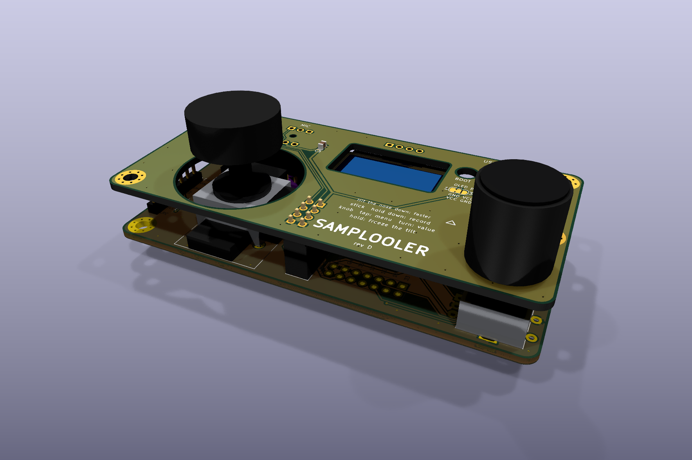
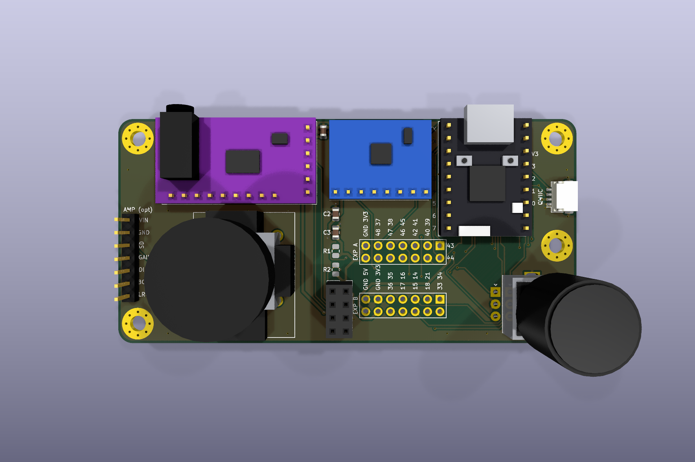
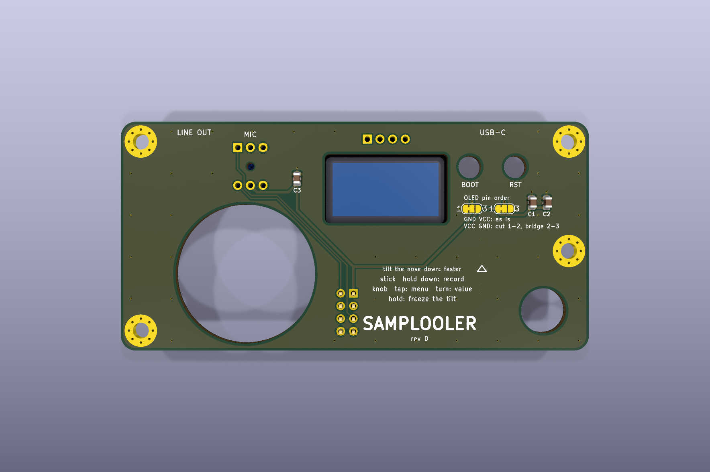
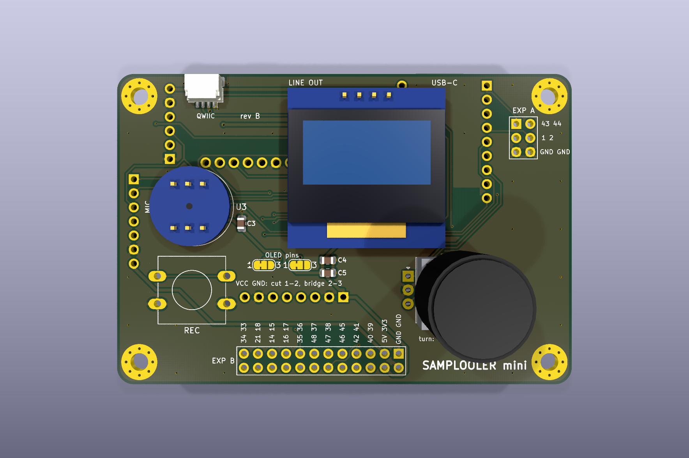
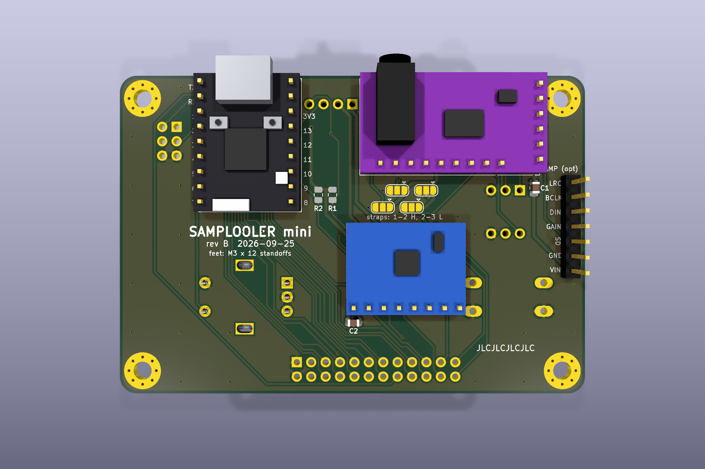
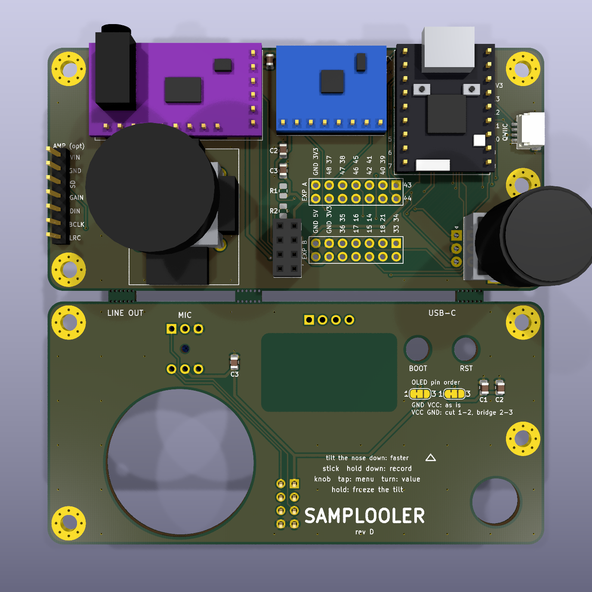
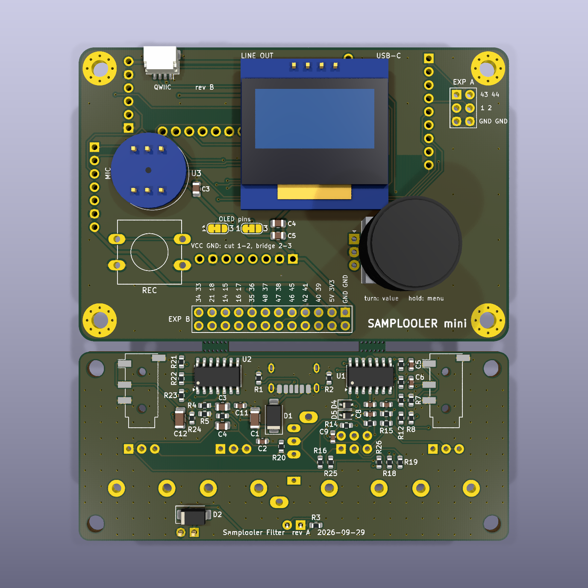

# Samplooler hardware

Two PCB designs for the ESP32-S3 build. Both are generated from the Python in `gen/`:

| | **Stack** | **Mini** |
| - | - | - |
| Boards | two, 94 × 46 mm, 11 mm apart on M3 standoffs, made as one 94 × 94 mm panel | one, 82 × 56 mm, parts on both faces |
| Controls | joystick (hold it down to record) and encoder | encoder and a 12 mm record button |
| Layout | bottom board: every module, the bare joystick, the encoder<br>top board: OLED and microphone hung underneath, seen and heard through a window and a port | front: OLED, mic, encoder, REC, breakouts<br>back: SuperMini, DAC, IMU, amp header |
| KiCad projects | `stack-bottom/`, `stack-top/` | `mini/` |

These are the stack's rev D files. Rev D has not been made. Rev C, the previous stack (the KY-023
on its own board, DAC straps, OLED and mic on top), is at the git tag `checkpoint/boards-rev-c`.

Both use the kit wiring from `firmware/main/pins.h`, plus these extras:

- **Pogo pins to the SuperMini's 20 underside pads**, for 20 more GPIOs: 14–18, 21, 33–42 and 45–48.
- **Breakouts for every spare GPIO**: labelled 2.54 mm pads, ready for a header or wires later. Each board has an EXP A and an EXP B.
- **Qwiic / STEMMA QT** (JST-SH, 3.3 V I2C) for sensors and add-ons.
- **Header for the optional MAX98357A amp**, which hangs off the left edge.
- **OLED pin-order jumpers**, so module variants need no rework.
- **The DAC's control pins tied on the board** (stack): FLT, DEMP and FMT low, XSMT high. The Mini
  still has strap jumpers for them.



| Stack, bottom board | Stack, top board |
| - | - |
|  |  |
| **Mini, front** | **Mini, back** |
|  |  |

## Order the boards (JLCPCB)

The stack's two boards come as one panel, 94 × 94 mm, so they fit JLC's 100 × 100 mm price.
They are joined by three 5 mm tabs across a 2 mm slot, each tab with a row of 0.5 mm mouse-bite
holes on both sides: snap them apart and file the nubs flush. Upload one zip from `fab/`:

| Design | Upload |
| - | - |
| Stack | `samplooler-panel-stack-jlcpcb.zip` (both boards; the single-board zips are there too) |
| Mini | `samplooler-mini-jlcpcb.zip` (the Mini on its own) |
| Mini + Filter | `samplooler-panel-mini-jlcpcb.zip`: the Mini and the Samplooler Filter on one 82 × 94 mm panel |

For either panel, also set **Panel by Customer**, and **Different Design** to 2. JLC
counts two designs on one panel as a different-design order and may charge for it; check
the price before you pay.

The **Samplooler Filter** is a companion board designed for the Mini's panel: an analog
resonant filter (DRIVE, CUTOFF, RESO, LEVEL, LP/BP/HP) for the looper's line out, powered from
USB-C or from the Mini's 5V pin. It lives in its own project, `~/Projects/samplooler-filter`
(circuit, simulation, build, README). The Mini panel joins the Mini's plain lower edge to the
Filter's back edge with two tabs, placed between the Filter's jacks and its USB-C socket. As
with everything here, neither board has been made yet.

| Stack panel (render) | Mini + Filter panel (render) |
| - | - |
|  |  |

| Setting | Value |
| - | - |
| Layers | 2 |
| Thickness | 1.6 mm FR-4 |
| Surface | HASL lead-free, or ENIG |
| Tracks / vias | 0.25 mm signal, 0.5–0.6 mm power, 0.6/0.3 mm vias, 0.5 mm to the edge: the standard process |
| Order number | "Specify a location": each board carries a `JLCJLCJLCJLC` text on its back (the panel has two; JLC uses one) |

The encoder's mounting lugs are plated slots, which the standard process covers. The stack's
openings for the stick, the shaft, BOOT and RST, and the screen's window, are routed from the outline.

The SMD parts are 0805 capacitors, two unfitted 0805 resistors and the pogo pins. The
capacitors are easy by hand. If you'd rather have JLC fit them, `fab/*-bom.csv` and
`fab/*-cpl.csv` are in JLC's SMT format. The panel's pair names each part with its board's
prefix (`BC1` is the bottom board's C1, `TC1` the top's), and JLC may want tooling rails added
for assembly, which the panel doesn't have. The Mini has parts on both faces.

## Parts

| Qty | Part | Stack | Mini |
| -: | - | - | - |
| 1 | ESP32-S3 SuperMini (ESP32-S3FH4R2) | bottom U1 | back U1 |
| 1 | GY-PCM5102 purple I2S DAC with 3.5 mm jack | bottom U2 | back U2 |
| 1 | INMP441 round I2S microphone | top U2, underneath | front U3 |
| 1 | GY-521 (MPU-6050) | bottom U4 | back U4 |
| 1 | SSD1306 0.96" 128×64 I2C OLED, 4 pins | top U1, underneath | front U5 |
| 1 | PS2-style thumb joystick, bare: the part on a KY-023, without its board | bottom U5 | – |
| 1 | 1 mm double-sided foam tape, about 5 × 20 mm | under the OLED's glass | – |
| 1 | EC11 encoder with push switch, vertical, plus a knob | bottom SW1, **25 mm shaft** | front SW1, 20 mm shaft |
| 1 | 12 × 12 mm tactile switch with a round cap | – | front SW2 |
| up to 20 | SMD pogo pins (see [below](#pogo-pins)) | bottom, under U1 | back, under U1 |
| 1 + 1 | 2×4 female socket, 8.5 mm tall, and a 2×4 male header | bottom J1, top J1 (underneath) | – |
| 1 | JST-SH 4-pin horizontal (SM04B-SRSS-TB) | bottom J3 | front J3 |
| 4 | M3 standoffs and 8 M3 screws | 11 mm, between the boards | 12 mm, as feet |
| strip | straight 2.54 mm header pins | the modules (about 55), plus any breakouts you fit | the same |
| 3 / 2 | 10 µF 0805 (LCSC C15850) | bottom C1 C2, top C1 | C1, C4 |
| 3 / 3 | 100 nF 0805 (LCSC C49678) | bottom C3, top C2 C3 | C2, C3, C5 |
| 0 | 4.7 k 0805 (LCSC C17673), not fitted | bottom R1 R2 | R1 R2 |
| 0–1 | MAX98357A breakout, Adafruit 3006 pin order | bottom J2 | back J2 |

R1 and R2 are I2C pull-ups. Fit them only if neither the OLED nor the GY-521 has its own
(both usually do).

## Pogo pins

The SuperMini sits on its headers 2.5 mm above the carrier. Spring pins on the carrier touch
the 20 pads on its underside. The pads are 1.753 mm apart down each column, so the pin's
base width matters more than its height. Every pad has a 1.5 mm square land.

| Pin | Fits | Where |
| - | - | - |
| Same Sky CPG-15-SMT-TR (recommended) | every pad | DigiKey / Same Sky, not at LCSC |
| SMD pogo pins with a Ø2 mm flange, e.g. YIYUAN (LCSC C5221287, C2988082, C5157384) | every other pad only | LCSC |
| Harwin P70 (LCSC C17702549), Mill-Max 0900 | only with a spacer: they don't match the 2.5 mm gap | |

You only need pins on the pads you use. Clamp the module while you solder its headers: the
springs push it up. Two checks on your own module:

- **Pad order in the column next to TX/RX.** The module's silkscreen says 48 at the top and
  39 at the bottom, but nologo's schematic shows the reverse. Meter it in diode mode: the pad
  marked 48 lights the module's RGB LED.
- **Strapping pins.** GPIO45 and GPIO46 must not be pulled high at power-up (45 high sets the
  flash to 1.8 V). GPIO48 drives the module's RGB LED. GPIO14–18 sit on ADC2, which Wi-Fi
  also uses.

## Breakouts

Every GPIO the design doesn't use goes to a breakout pad with its number on the silkscreen.
The pin order follows the fixed escape from the SuperMini (see
[how the boards are laid out](#how-the-boards-are-laid-out)), which is why the numbers aren't
sequential. On the stack, both rows sit in the middle of the bottom board, under the top
board: solder wires to the pads, or fit plain straight headers (2.5 mm plastic plus about
6 mm of pin clears the 11 mm gap) and connect to them before the top board goes on. There is
no room for Dupont housings between the boards.

**Stack, EXP A** (upper row, left to right; pin 1 is top right)

| | | | | | | | |
| - | :-: | :-: | :-: | :-: | :-: | :-: | :-: |
| top | GND | 48 | 47 | 46 | 42 | 40 | 43 TX |
| bottom | 3V3 | 37 | 38 | 45 | 41 | 39 | 44 RX |

**Stack, EXP B** (lower row, left to right; pin 1 is top right)

| | | | | | | | |
| - | :-: | :-: | :-: | :-: | :-: | :-: | :-: |
| top | GND | GND | 36 | 17 | 15 | 18 | 33 |
| bottom | 5V | 3V3 | 35 | 16 | 14 | 21 | 34 |

**Mini, EXP A** (right edge, top to bottom)

| | | |
| -: | :-: | :-: |
| 1 · 2 | 43 TX | 44 RX |
| 3 · 4 | 1 | 2 |
| 5 · 6 | GND | GND |

**Mini, EXP B** (bottom edge, left to right; pin 1 is top right)

| | | | | | | | | | | | | |
| - | :-: | :-: | :-: | :-: | :-: | :-: | :-: | :-: | :-: | :-: | :-: | :-: |
| top | 34 | 21 | 14 | 16 | 35 | 48 | 47 | 46 | 42 | 40 | 5V | GND |
| bottom | 33 | 18 | 15 | 17 | 36 | 37 | 38 | 45 | 41 | 39 | 3V3 | GND |

On the Mini, GPIO1 and GPIO2 (the stack's joystick pins, ADC1) are free, so EXP A breaks them out.

## Before you order: measure these

Cheap modules differ between sellers. Where sources disagreed, the pads sit at the midpoint
and the drills are opened up. A minute with calipers confirms these:

| Check | Designed for | Tolerance built in |
| - | - | - |
| SuperMini: distance between its two pin rows | 15.33 mm (sources say 15.24 to 15.46) | 1.1 mm drills fit either |
| DAC: the 9-pin row (FLT…LROUT) against the 6-pin header | 6.475 mm in, 0.65 mm up from SCK | 1.2 mm drills |
| OLED: pin order | GND VCC SCL SDA | jumpers swap GND and VCC, see below |
| OLED (stack): active area against the header | 21.7 × 10.9 mm, its top edge 4.5 mm below the pins | window 1.5 mm larger all round (24.7 × 13.9 mm) |
| Joystick (stack): switch legs | rows 7.81 and 12.6 mm from the stick, 6.35 mm apart across | 1.2 mm drills (Adafruit's footprint says 8.0 / 12.5, SparkFun's 7.62 / 12.7) |
| **Joystick (stack): from the bottom of its frame to the underside of the cap** | 20 mm, an estimate: no maker drawing found | at full tilt (25°) the cap's rim stays over the top board from about 18.5 mm (20 mm if it tilts 30°); lower, and it can touch the board |

## Assembly

### Stack

1. **Snap the panel apart** and file the tab nubs flush.
2. **SMD first**: the capacitors, then any pogo pins under where the SuperMini goes.
3. **Joystick**: the bare stick (a KY-023's, off its board, or bought on its own) straight onto
   the bottom board, switch toward the player's edge. Solder the four frame tabs too, then trim
   the legs underneath to 2 mm.
4. **Modules onto the bottom board**, each on straight headers with the plastic between module
   and carrier. Then the encoder (25 mm shaft) and the 2×4 socket J1. Trim the tails
   underneath. Fit the DAC's 9-pin row as well: the board ties FLT, DEMP and FMT to GND and
   XSMT to the DAC's own 3.3 V (A3V3) through it, so no straps to set. That matches the
   bridges on the DAC's back if they are set as usual (L, L, H, L). A floating FMT flips the
   DAC between data formats when you touch it: loud distortion. A floating XSMT keeps it silent.
5. **Top board**: the OLED and the mic hang underneath it, facing up.
   - OLED: fit its 4-pin header from the glass side, plastic between the glass side and the
     board, the long pins up through the board (most come with the header the other way
     round). A strip of 1 mm foam tape on the glass's lower end, hidden behind the board, keeps
     it level. If its first two pins read VCC GND instead of GND VCC, cut the thin 1–2 bridges
     on JP1 and JP2 and solder 2–3 on both.
   - Mic: sound hole up over the 1.5 mm port, flush against the board (no plastic in between).
     Trim the pin stubs below it.
   - The 2×4 header J1 from underneath (plastic below the board, soldered on top).
6. **Stack**: four 11 mm standoffs on the bottom board, press the header into the socket,
   screw down.
7. **Bottom cover** (optional): `enclosure/stack-cover.scad` is a printed tray that clicks onto
   the bottom board's underside and covers the solder joints; see `docs/ENCLOSURE.md`. Unprinted.

To flash from the browser, hold BOOT while plugging in. Reach it through the hole in the top
board with a toothpick.

### Mini

Parts on both faces hide each other's solder joints, so the order matters. The build works it
out:

**J2 (amp header) → SuperMini U1 → DAC U2 → mic U3 → IMU U4 → OLED U5**

After that come the encoder, the record button, the breakouts and the four feet. The encoder's
mounting lugs are soldered for strength only: on the Mini they aren't connected to GND. Trim the
SuperMini's and the DAC's pin tails flush on the front before the mic and the OLED go over
them. The DAC straps JP1–JP4 are on the back: bridge FLT, DEMP and FMT to L (2–3) and XSMT to H
(1–2), unless the DAC's own bridges are already set; a floating FMT distorts at a touch, a floating
XSMT keeps the DAC silent. The OLED jumpers JP5/JP6 on the front work as on the stack.

On both designs, the **nose** is the edge with USB-C and the jack. Tilting the nose down plays
forward, faster with angle.

## Firmware notes

- **Stack:** runs the current firmware unchanged. Pressing the stick down is the record button
  (GPIO3). Its axes are wired (X on GPIO2, Y on GPIO1, pots between 3V3 and GND as on Adafruit's
  breakout) but unused while `HAS_JOY` is 0. If you turn it on, check which way each axis
  reads and flip its sign in `firmware/main/input.c` if needed.
- **Mini:** needs three small firmware changes, not made yet:
  - Record on GPIO3, the record button (the joystick's old click pin). The SuperMini has a
    100k/100k divider from USB 5V on GPIO3; a button to GND still reads fine.
  - Menus on the encoder: hold = menu, tap = next, as on the C3.
  - `ROLL_SIGN -1`: the IMU sits upside down on the back. Its +X still points at the nose, so
    pitch is unchanged.

## Checks every build runs

| Check | Result |
| - | - |
| ERC, every schematic, every severity | 0 findings |
| DRC with schematic parity, every board, every severity, on the saved copper fill that the Gerbers are plotted from | 0 findings |
| Routing | every connection routed on all three boards, and no two tracks of different nets touching |
| 3D mechanical model (`gen/mech.py`) | 0 collisions |
| Stack: J1 socket against J1 header | mate pin for pin |
| Stack panel (`gen/panel.py`) | fits 95 × 95 mm |

The mechanical model covers:

- every part's height, from its header plastic up
- tall features: USB-C, the jack, the joystick frame, and the volume its stick and cap sweep at full tilt, the encoder bushing, shaft and knob
- the OLED and the mic hung under the top board, over the modules on the bottom one
- pin tails through the board
- the openings in the top board, the standoffs and the board edges
- on the Mini, which module hides which solder joint

The Mini is two-sided on purpose, so KiCad's generic "PTH inside courtyard" check is switched
off there. The mechanical model checks heights and solder order instead.

## How the boards are laid out

- **Power:** USB-C on the SuperMini feeds everything. Its 5 V pin feeds the DAC and the amp.
  Its 3.3 V regulator feeds the IMU, joystick, mic, OLED, Qwiic and the breakouts.
  Decoupling capacitors sit near the modules' supply pins. On the Mini, the IMU's capacitor
  is wired straight onto its pins.
- **The SuperMini escape:** the underside pads sit 1.753 mm apart in three columns, too tight
  for an autorouter. A fixed, locked escape (`kit.supermini_escape`) brings each pad out:
  - column C on the pads' own layer
  - column B and the top of column A through a via to the other layer
  - the bottom of column A straight out
  - the 5 V and 3.3 V risers alongside

  All the lines end in one row just below the module.
- **Breakout order:** each breakout takes those lines in the order they arrive, so no two
  cross on the way in. That order is the pin numbering above. On the stack, both rows lie
  left of the escape with a channel between them: the lines drop into it and run left, the
  top ones climb into EXP A from below (so EXP A takes them in reverse), the rest drop into
  EXP B from above. TX and RX come straight down onto EXP A's right-hand pair.
- **Routing:** Freerouting joins everything else. Its preferred directions and via cost are
  set per run, and the build keeps the best of a few settings. Afterwards it removes any
  escape stub the router made redundant.
- **Ground:** both layers are GND pours, stitched with vias. A last step works on the fill as
  plotted: it ties any GND pad or pour pocket the routing walled in back to a plane, then DRC
  confirms. On the stack's bottom board, two GND tracks are laid before routing: a spine along
  the bottom edge (the escape bundle would otherwise cut the pour in two) and a tie from EXP
  B's GND pins to the link socket. XSMT's tie to the DAC's 3.3 V is laid too, hooked under FMT
  on the back.
- **Antenna:** no copper under the SuperMini's chip antenna.
- **Stack link:** the 2×4 connector carries I2C (OLED) and I2S (mic) to the top board, with
  GND on its bottom row.

## Regenerating

Everything under `stack-bottom/`, `stack-top/`, `panel-stack/`, `mini/`, `lib/`, `fab/` and `images/` is
generated by the scripts in `gen/`. Nothing was drawn by hand in the KiCad GUI.

```sh
python3 hardware/gen/build.py              # both designs: library, schematics + ERC, PCBs, routing, DRC, fab files
python3 hardware/gen/build.py mini         # one design
python3 hardware/gen/build.py --check      # the mechanical model only
python3 hardware/gen/panel.py              # the panels, from the built boards: panel-stack/, panel-mini/, fab/
python3 hardware/gen/render.py             # images/
```

You need KiCad 10 (`kicad-cli` and its `pcbnew` Python module) and Freerouting 2.4.1 at
`~/.local/share/freerouting/freerouting-2.4.1-linux-x64/`. That's the Linux bundle, which
brings its own Java. The build refuses to run while KiCad has one of the projects open,
because it rewrites every file.

| File | What |
| - | - |
| `gen/stack.py`, `gen/mini.py` | the two designs: parts, nets, placement, breakout order, silkscreen |
| `gen/modules.py` | module geometry: pins, outlines, tall features, the pogo pad map, the tolerances above |
| `gen/parts.py` | stock parts: footprints, LCSC numbers, mechanics |
| `gen/kit.py` | shared steps: library, schematic layout, placement, SuperMini escape, routing, pours, GND rescue, DRC, fab |
| `gen/mech.py` | the mechanical model |
| `gen/panel.py` | the panels (stack; Mini + Filter) with mouse-bite tabs, and their merged BOM/CPL |
| `gen/schematic.py`, `gen/footprints.py`, `gen/models.py` | writers for `.kicad_sch`, `.kicad_mod`, VRML bodies |
| `lib/` | the generated symbol, footprint and 3D-model libraries |

## Licence

The board files, renders and fab outputs are CC BY-SA 4.0 ([LICENSE](LICENSE) in this folder). The
generator in `gen/` is GPL-3.0, like the rest of the tools (the repository's [LICENSE](../LICENSE)).
