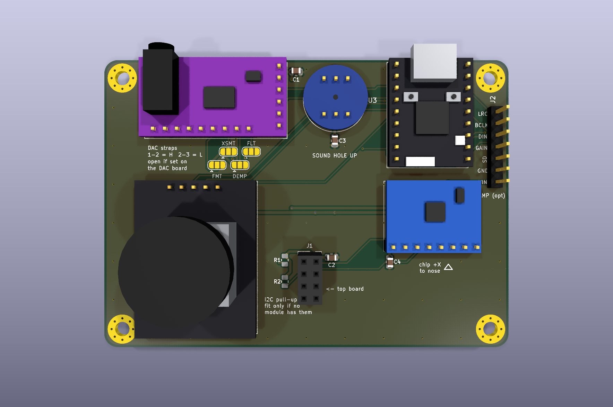
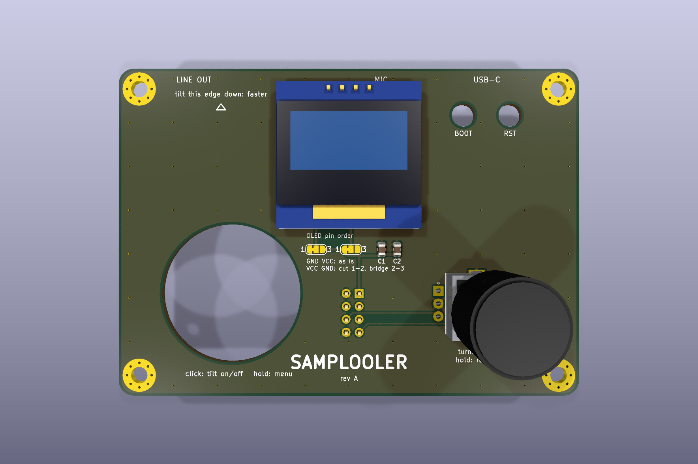
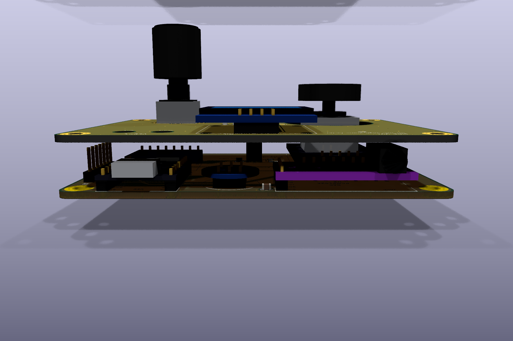

# Samplooler hardware: a two-board stack for the S3 build


Two 90 × 64 mm boards, 11 mm apart on M3 standoffs:

- **bottom** carries the modules: ESP32-S3 SuperMini, GY-PCM5102 DAC, INMP441 mic,
  GY-521 (MPU-6050), KY-023 joystick, and a header for the optional MAX98357A amp.
- **top** is the panel: the 0.96" SSD1306 OLED, the EC11 encoder, an opening for the
  joystick, and access holes over the SuperMini's BOOT and RST buttons.

They meet through a 2×4 connector: an 8.5 mm female socket on the bottom board and a male
header fitted to the underside of the top board. Socket plus header plastic is 11.0 mm,
which is the standoff length.

Everything is the same circuit as the kit wiring in `firmware/main/pins.h`, so the
firmware runs unchanged.

| | |
| - | - |
| Bottom board |  |
| Top board |  |
| From the nose edge |  |

## Order the boards (JLCPCB)

Upload each zip as its own PCB:

- `fab/samplooler-bottom-jlcpcb.zip`
- `fab/samplooler-top-jlcpcb.zip`

| Setting | Value |
| - | - |
| Layers | 2 |
| Size | 90 × 64 mm (read from the Gerbers) |
| Thickness | 1.6 mm FR-4 |
| Surface | HASL lead-free (or ENIG) |
| Min track / via | 0.25 mm tracks, 0.3 mm via drill: standard process, no extra cost |
| Order number | "Specify a location": the `JLCJLCJLCJLC` text on the back of each board |

The drills include plated slots for the encoder's mounting lugs, which the standard
process covers. The joystick opening and the BOOT/RST holes are routed from the outline.

The only SMD parts are 0805 capacitors (and two unfitted 0805 resistors), easy by hand.
If you would rather have JLC fit them, `fab/*-bom.csv` and `fab/*-cpl.csv` are in JLC's
SMT format (top side only, basic parts).

## Parts

| Qty | Part | Where |
| -: | - | - |
| 1 | ESP32-S3 SuperMini (ESP32-S3FH4R2) | bottom U1 |
| 1 | GY-PCM5102 purple I2S DAC with 3.5 mm jack | bottom U2 |
| 1 | INMP441 round I2S microphone | bottom U3 |
| 1 | GY-521 MPU-6050 breakout | bottom U4 |
| 1 | KY-023 joystick | bottom U5 |
| 0–1 | MAX98357A breakout, Adafruit 3006 pin order (optional) | bottom J2 |
| 1 | SSD1306 0.96" 128×64 I2C OLED, 4-pin | top U1 |
| 1 | EC11 encoder with push switch, vertical, 20 mm shaft, plus a knob | top SW1 |
| 1 | 2×4 female socket, 2.54 mm, 8.5 mm tall | bottom J1 |
| 1 | 2×4 male header, 2.54 mm, standard 2.5 mm plastic | top J1 (underneath) |
| ~60 | Straight male header pins, 2.54 mm (breakaway strip) | module headers |
| 4 | M3 × 11 mm female-female standoffs (or 10 mm plus a 1 mm washer) and 8 M3 × 6 screws | corners |
| 3 | 10 µF 0805 capacitor (LCSC C15850) | bottom C1 C2, top C1 |
| 3 | 100 nF 0805 capacitor (LCSC C49678) | bottom C3 C4, top C2 |
| 0 | 4.7 k 0805 resistor (LCSC C17673), not fitted | bottom R1 R2 |
| 4 | Optional: M2 × 2.5 mm spacers and M2 screws for the OLED corners | top |

## Before you order: measure these

Cheap modules differ between sellers. Where the sources disagreed I put the holes at the
midpoint and opened up the drills. A minute with calipers confirms these:

| Check | Designed for | Tolerance built in |
| - | - | - |
| SuperMini: distance between its two pin rows | 15.33 mm (sources say 15.24 to 15.44) | 1.1 mm drills: a real 15.24 or 15.44 still fits |
| DAC: the 9-pin row (FLT…LROUT) against the 6-pin header | 6.475 mm in, 0.65 mm up from SCK | 1.2 mm drills; that row is optional anyway |
| OLED: pin order | GND VCC SCL SDA | top JP1/JP2 swap GND and VCC, see below |
| OLED: corner holes | 23.3 × 23.8 mm grid | 2.5 mm holes for M2; the header alone also holds it |
| KY-023: stick centre vs its header | 17 mm from the header edge, 1 mm toward GND | 27 mm opening, gimbal needs 23 |
| KY-023: M3 holes | 26.5 × 20.5 mm | optional; the 5-pin header carries it |

## Assembly

1. **SMD capacitors first**, on both boards (C1 to C4 bottom, C1 and C2 top). Leave R1/R2
   empty unless neither the OLED nor the GY-521 has I2C pull-ups.
2. **DAC straps, bottom JP1 to JP4.** The DAC board's own H1L to H4L bridges are on its
   back, which you cannot reach once it is mounted. If your DAC came with those bridges
   set, leave JP1 to JP4 open. If they are open, bridge FLT = L, DEMP = L, XSMT = H,
   FMT = L here (1–2 = H, 2–3 = L). An open XSMT means a silent DAC.
3. **Joystick:** desolder the right-angle header and fit a straight one.
4. **Modules onto the bottom board**, each on straight male headers with the plastic
   between module and carrier, so every module sits 2.5 mm up. Solder the carrier side
   last and trim the tails flush underneath.
   - **Microphone:** the sound hole goes **up**. The header plastic goes on the side with
     the metal can, and the can sits in the 2.5 mm gap.
   - **DAC:** the 6-pin header, and the 9-pin row too if you can. It holds the board
     against the force of plugging in the jack, and carries the straps from step 2.
   - **SuperMini:** USB-C faces the board edge.
   - **J2**, only if you fit the amp. Its module hangs off the right edge, with the speaker
     terminal outside the stack.
5. **Bottom J1:** the 2×4 female socket.
6. **Top board:**
   - **Encoder** from the top.
   - **OLED** from the top, on its own header.
   - **J1:** the 2×4 male header goes in from **underneath**, plastic below the board,
     soldered on top.
   - **OLED pin order:** if your OLED's first two pins read VCC GND instead of GND VCC,
     cut the thin 1–2 bridge on JP1 and JP2 and solder 2–3 on both.
7. **Stack:** four standoffs on the bottom board, press the top board's header into the
   socket, screw down.

The tilt "nose" is the edge with USB-C, the jack and the mic. Tilting that edge down plays
forward, faster with angle. The MPU-6050's +X axis points at it, which is the orientation
the firmware's `TILT_SIGN +1` expects. Roll left feeds the delay, roll right the stutter.

To flash from the browser, hold BOOT while plugging in. Reach it through the hole in the
top board with a toothpick or a 2 mm rod.

## Checks the design passed

| Check | Result |
| - | - |
| ERC, both schematics, every severity | 0 findings |
| DRC, both boards, every severity including warnings, on the saved copper fill the Gerbers are plotted from | 0 findings |
| Schematic ↔ PCB parity (`kicad-cli pcb drc --schematic-parity`) | clean |
| Mechanical model of the 11 mm gap (`gen/layout.py: mechanical_check`) | 0 collisions |
| Rules | JLC standard: 0.2 mm clearance, 0.25 mm signal / 0.5–0.6 mm power tracks, 0.6/0.3 mm vias, 0.5 mm to the edge |

The mechanical check models:

- every module's height above the carrier, counting its 2.5 mm header plastic
- the untrimmed header tails and OLED M2 screws under the top board, and the encoder's pins
- the jack, which is the tallest part at 9.6 mm, so nothing hangs above it
- the joystick gimbal passing through the opening, and the swing of its cap
- the standoffs and the board edges

## How the boards are laid out

- **Power:** the SuperMini's USB 5V feeds the DAC (and the amp); its 3.3 V regulator
  feeds the mic, IMU, joystick, OLED and encoder. Both rails are hand-routed at 0.6 mm:
  - risers run under the SuperMini, where the carrier is free because the module sits on
    headers
  - a 5V and a 3V3 line run across the board at y ≈ 33 mm
  - each load gets a short branch; the DAC, mic, IMU and the feed to the top board each
    have a 10 µF or 100 nF capacitor right at the pin
- **Signals** are routed by Freerouting around those locked power lines. Both copper layers
  are poured with GND and stitched with vias. The one pour island that stayed cut off got
  its own via.
- **Antenna:** no copper pour under the SuperMini's chip antenna. Nothing uses the radio
  today, but BLE-MIDI stays possible.
- **Joystick:** mounted a quarter turn clockwise, header toward the MCU. That is the same
  as the kit case, so `input.c`'s axis mapping (`x = ay, y = -ax`) applies unchanged.
  Published KY-023 wiring suggests left/right may come out mirrored in both the kit and
  here. If so, change it to `x = -ay` in `firmware/main/input.c`.

## Regenerating

Everything under `bottom/`, `top/`, `lib/`, `fab/` and `images/` is generated by the
scripts in `gen/`. Nothing was drawn by hand in the KiCad GUI.

```sh
python3 hardware/gen/build.py        # library, schematics + ERC, PCBs, routing, pours, DRC, fab zips
python3 hardware/gen/render.py       # images/*.png, including the stacked render
```

Needs KiCad 10 (`kicad-cli` and its `pcbnew` Python module) and Freerouting 2.4.1 at
`~/.local/share/freerouting/freerouting-2.4.1-linux-x64/`. That is the Linux bundle,
which brings its own Java 25. `build.py --no-route` skips the router.

| File | What |
| - | - |
| `gen/modules.py` | module geometry: pin order, outlines, the tolerances above |
| `gen/build.py` | netlists, schematic layout, project setup, routing and fab steps |
| `gen/layout.py` | placement, the mechanical model, hand-routed power, stitching |
| `gen/schematic.py`, `gen/footprints.py`, `gen/models.py` | writers for `.kicad_sch`, `.kicad_mod`, VRML bodies |
| `lib/` | the project symbol, footprint and 3D-model libraries |
