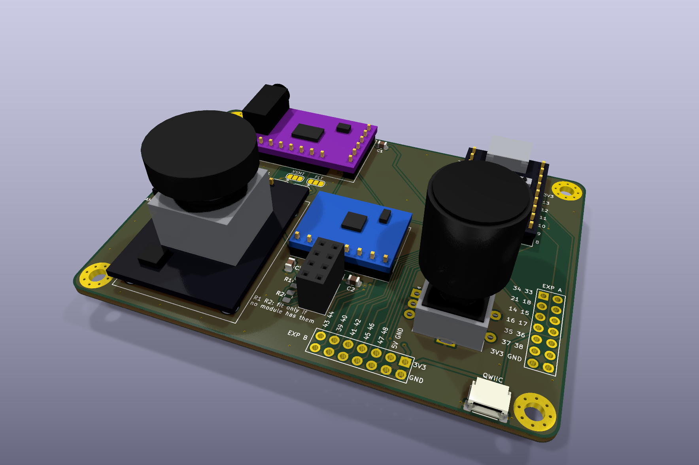
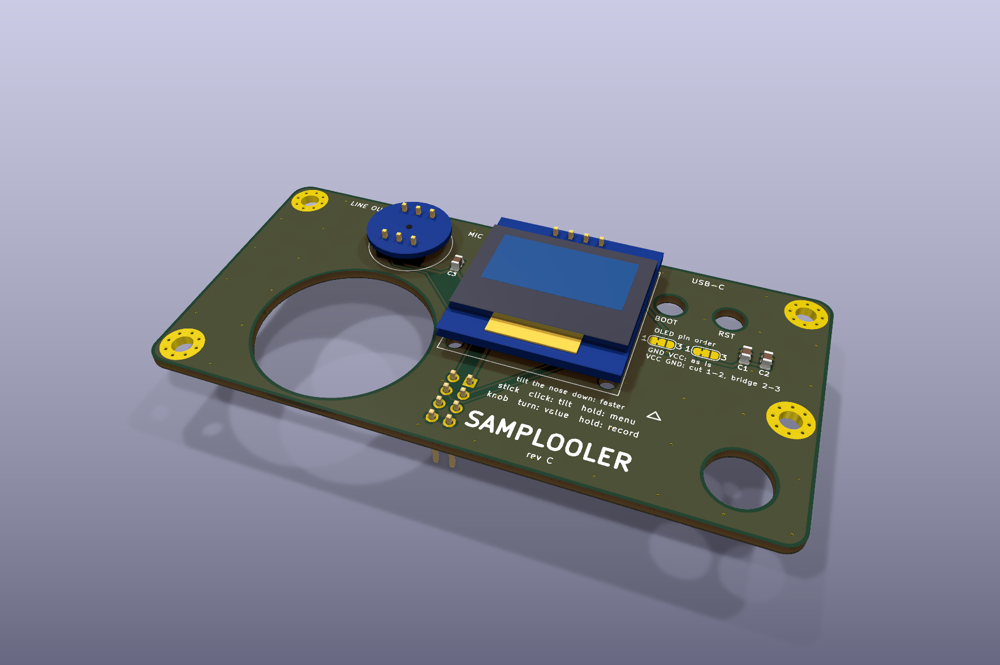

# Samplooler Stack boards

Two boards, 94 x 46 mm, 11 mm apart on M3 standoffs, made as one 94 x 94 mm panel. The bottom board carries every
module, the bare joystick and the encoder. The top board hangs the OLED and the microphone underneath it, seen and
heard through a window and a port. The modules sit on straight headers; the pins follow `firmware/main/pins.h`.

Rev C is the current board: it was made and runs the firmware, and the screen, microphone, tilt, line out and USB
MIDI/audio work. Its files are at the git tag `checkpoint/boards-rev-c`. Rev C has the KY-023 joystick on its own
little board, DAC strap jumpers, and the OLED and the mic on top of the top board. The files here are rev D, which
is being tested now (October 2026).

Both rev D boards pass ERC and DRC with no findings; the reports are in each project folder. How to build one is in
[docs/BUILD.md](../docs/BUILD.md).

## What is on each board

| Board | Ref | Part | Notes |
| - | - | - | - |
| Bottom | U1 | ESP32-S3 SuperMini (ESP32-S3FH4R2) | 20 pogo pads underneath |
| Bottom | U2 | GY-PCM5102 DAC with 3.5 mm jack | control pins tied on the board through its 9-pin row |
| Bottom | U4 | GY-521 (MPU-6050) | the tilt sensor |
| Bottom | U5 | PS2-style joystick, bare (the part on a KY-023) | its click is the record button (GPIO 3); X and Y go to GPIO 2 and 1, unused by the firmware |
| Bottom | SW1 | EC11 encoder with push, 25 mm shaft | |
| Bottom | J1 | 2 x 4 socket | the link to the top board: I2C for the OLED, I2S for the mic, GND |
| Bottom | J2 | header for a MAX98357A amp | optional |
| Bottom | J3 | Qwiic, JST-SH 4-pin | optional |
| Bottom | J4, J5 | EXP A, EXP B | breakouts, below |
| Bottom | C1 to C3 | 10 µF, 10 µF, 100 nF, 0805 | |
| Bottom | R1, R2 | 4.7 k I2C pull-ups, 0805 | not fitted |
| Top | U1 | SSD1306 0.96" OLED, 4 pins | underneath, seen through a window |
| Top | U2 | INMP441 microphone | underneath, hears through a 1.5 mm port |
| Top | J1 | 2 x 4 header | underneath, into the bottom board's socket |
| Top | JP1, JP2 | OLED pin-order jumpers | |
| Top | C1 to C3 | 10 µF, 100 nF, 100 nF, 0805 | |

The top board has openings for the stick, the encoder shaft, BOOT and RST. The full parts list with quantities is
in [docs/BUILD.md](../docs/BUILD.md#parts).

## Extras

| Extra | What it is |
| - | - |
| Pogo pins | Spring pins on the bottom board touch the SuperMini's 20 underside pads, for 20 more GPIOs: 14 to 18, 21, 33 to 42 and 45 to 48. They only feed the breakouts; the Samplooler does not need them. |
| EXP A, EXP B | Every GPIO the design does not use, on labelled 2.54 mm pads in the middle of the bottom board, under the top board. Solder wires, or fit plain straight headers (2.5 mm plastic plus about 6 mm of pin clears the 11 mm gap) and connect them before the top board goes on. There is no room for Dupont housings between the boards. |
| Qwiic | JST-SH, 3.3 V I2C, for sensors and add-ons. |
| Amp header | For the optional MAX98357A (Adafruit 3006 pin order), which hangs off the left edge. It takes 5 V. |
| OLED pin-order jumpers | JP1 and JP2 swap GND and VCC, so both common OLED pin orders fit without rework. |
| DAC pins tied | FLT, DEMP and FMT to ground, XSMT to the DAC's own 3.3 V, through the DAC's 9-pin row. No straps to set. |

EXP A, upper row, left to right; pin 1 is top right:

| | | | | | | | |
| - | :-: | :-: | :-: | :-: | :-: | :-: | :-: |
| top | GND | 48 | 47 | 46 | 42 | 40 | 43 TX |
| bottom | 3V3 | 37 | 38 | 45 | 41 | 39 | 44 RX |

EXP B, lower row, left to right; pin 1 is top right:

| | | | | | | | |
| - | :-: | :-: | :-: | :-: | :-: | :-: | :-: |
| top | GND | GND | 36 | 17 | 15 | 18 | 33 |
| bottom | 5V | 3V3 | 35 | 16 | 14 | 21 | 34 |

The numbers are not in order because each row takes the lines in the order they come out from under the SuperMini.

The SuperMini sits on its headers 2.5 mm above the board, and its pads are 1.753 mm apart down each column, so the
pogo pin's base width matters more than its height. You only need pins on the pads you use. Clamp the module while
you solder its headers: the springs push it up.

| Pogo pin | Fits | Where |
| - | - | - |
| Same Sky CPG-15-SMT-TR | every pad | DigiKey, Same Sky; not at LCSC |
| SMD pogo pins with a 2 mm flange, e.g. YIYUAN (LCSC C5221287, C2988082, C5157384) | every other pad only | LCSC |
| Harwin P70 (LCSC C17702549), Mill-Max 0900 | only with a spacer: they don't match the 2.5 mm gap | |

Two checks on your own SuperMini. The silkscreen of the pad column next to TX/RX says 48 at the top and 39 at the
bottom, but nologo's schematic shows the reverse: meter it in diode mode, the pad marked 48 lights the module's RGB
LED. And GPIO 45 and 46 must not be pulled high at power-up (45 high sets the flash to 1.8 V).

## Pictures

| Bottom board | Top board |
| - | - |
|  |  |
|  |  |

| From the nose | The panel |
| - | - |
|  |  |

The back of the panel: [images/panel-stack-back.png](images/panel-stack-back.png). All renders, from KiCad.

> PHOTO: the rev D boards as made, both faces, bare and with the modules on

## Ordering from JLCPCB

The two boards come as one panel, 94 x 94 mm, so they fit JLC's 100 x 100 mm price. They are joined by three 5 mm
tabs across a 2 mm slot, each tab with a row of 0.5 mm mouse-bite holes on both sides: snap them apart and file the
nubs flush.

Upload `fab/samplooler-panel-stack-jlcpcb.zip`. Also set Panel by Customer, and Different Design to 2. JLC counts
two designs on one panel as a different-design order and may charge for it; check the price before you pay.

| Setting | Value |
| - | - |
| Layers | 2 |
| Thickness | 1.6 mm FR-4 |
| Surface | HASL lead-free, or ENIG |
| Tracks / vias | 0.25 mm signal, 0.5 to 0.6 mm power, 0.6/0.3 mm vias, 0.5 mm to the edge: the standard process |
| Order number | "Specify a location": each board carries a `JLCJLCJLCJLC` text on its back (the panel has two; JLC uses one) |

The encoder's mounting lugs are plated slots, which the standard process covers. The openings for the stick, the
shaft, BOOT and RST, and the screen's window, are routed from the outline.

The SMD parts are the 0805 capacitors, the two unfitted 0805 resistors and the pogo pins. The capacitors are easy
by hand. If you'd rather have JLC fit them, the BOM and CPL files are in JLC's SMT format. The panel's pair names
each part with its board's prefix (`BC1` is the bottom board's C1, `TC1` the top's), and JLC may want tooling rails
added for assembly, which the panel doesn't have.

| File in `fab/` | What |
| - | - |
| [samplooler-panel-stack-jlcpcb.zip](fab/samplooler-panel-stack-jlcpcb.zip) | Gerbers and drill files for the panel, both boards. The one to upload. |
| [samplooler-panel-stack-bom.csv](fab/samplooler-panel-stack-bom.csv), [-cpl.csv](fab/samplooler-panel-stack-cpl.csv) | the panel's capacitors, for JLC assembly |
| [samplooler-stack-bottom-jlcpcb.zip](fab/samplooler-stack-bottom-jlcpcb.zip), [samplooler-stack-top-jlcpcb.zip](fab/samplooler-stack-top-jlcpcb.zip) | each board on its own |
| [samplooler-stack-bottom-bom.csv](fab/samplooler-stack-bottom-bom.csv), [-cpl.csv](fab/samplooler-stack-bottom-cpl.csv) | the bottom board's capacitors |
| [samplooler-stack-top-bom.csv](fab/samplooler-stack-top-bom.csv), [-cpl.csv](fab/samplooler-stack-top-cpl.csv) | the top board's capacitors |
| [samplooler-stack-bottom-schematic.pdf](fab/samplooler-stack-bottom-schematic.pdf), [samplooler-stack-top-schematic.pdf](fab/samplooler-stack-top-schematic.pdf) | the schematics |

## Before you order: measure these

Cheap modules differ between sellers. Where sources disagreed, the pads sit at the midpoint and the drills are
opened up. A minute with calipers confirms these:

| Check | Designed for | Tolerance built in |
| - | - | - |
| SuperMini: distance between its two pin rows | 15.33 mm (sources say 15.24 to 15.46) | 1.1 mm drills fit either |
| DAC: the 9-pin row (FLT to LROUT) against the 6-pin header | 6.475 mm in, 0.65 mm up from SCK | 1.2 mm drills |
| OLED: pin order | GND VCC SCL SDA | the jumpers swap GND and VCC |
| OLED: active area against the header | 21.7 x 10.9 mm, its top edge 4.5 mm below the pins | window 1.5 mm larger all round (24.7 x 13.9 mm) |
| Joystick: switch legs | rows 7.81 and 12.6 mm from the stick, 6.35 mm apart across | 1.2 mm drills (Adafruit's footprint says 8.0 / 12.5, SparkFun's 7.62 / 12.7) |
| Joystick: from the bottom of its frame to the underside of the cap | 20 mm, an estimate: no maker drawing found | at full tilt (25 degrees) the cap's rim stays over the top board from about 18.5 mm (20 mm if it tilts 30 degrees); lower, and it can touch the board |

## Opening them in KiCad

KiCad 10. Each folder is a project; the module symbols, footprints and 3D models come from `lib/` through the
projects' own library tables.

| Folder | What |
| - | - |
| [stack-bottom/](stack-bottom/) | the bottom board: schematic, PCB, ERC and DRC reports |
| [stack-top/](stack-top/) | the top board: the same |
| [panel-stack/](panel-stack/) | the two boards on one panel, as ordered |
| [lib/](lib/) | the symbol, footprint and 3D-model libraries for the modules |

## Licence

The board files, renders and fab outputs are CC BY-SA 4.0 ([LICENSE](LICENSE)).
