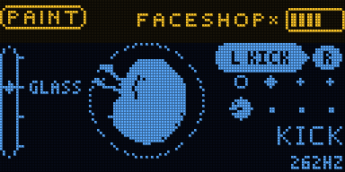
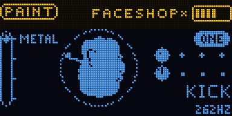
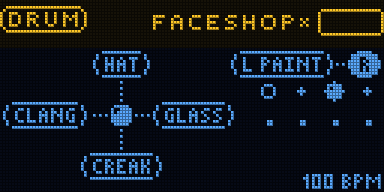
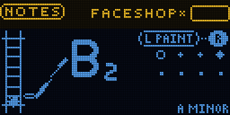
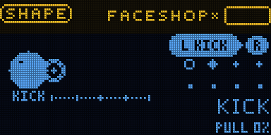
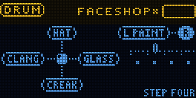
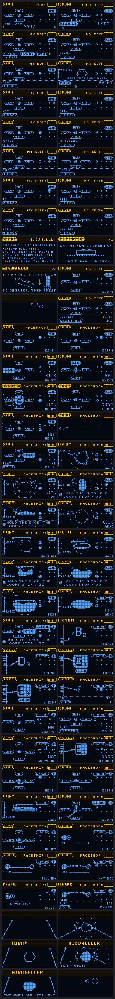

# AIRDWELLER

Two boxes, one in each hand.

AIRDWELLER puts AIR's air drumming and DWELL's pumping into one instrument for two hands. Each box has a role. A DRUM
box is swung like a stick: forward, left, right and back are four pads, and every hit lands on the beat. A PAINT box
holds a material that rings (metal, glass, rubber or latex), struck by the other hand's hits at the same instant and
tuned to its kick; while it rings, tilting it moves to another material, twisting bends the pitch, rolling it changes
the brightness, moving it bows it and shaking it scrapes it. A PUMP box bows that material instead: moving pumps it
up, holding still lets it fall, and the other hand's hits duck it.

So a kick in the left hand can strike a metal plate in the right, and the plate rings on the kick's note. Two DRUM
boxes are one kit split across the hands; two PUMP boxes are a drone you work with both arms. One box alone plays a
mixed kit.

A hit is a swing that stops, as a stick stops on a drum; the directions are the room's, measured against gravity, so
the angle you hold the box at does not matter, and a twist of the wrist is never a hit. After a hit, keep moving
slowly and you drag the sound you made: the kick bends down and stretches, the snare's tail hangs on, the hat opens,
the metal keeps ringing. A NOTES box draws basslines and leads: the tilt picks the note of the scale, a flick plays it
short, and moving on holds it and slides it. A SHAPE box plays nothing and drags the other hand's sounds instead. EASY
lets any swing, any way, play the next step of a pattern, so shaking or dancing plays a beat.

The drums are made from nothing, no samples, after SOPHIE's records (FACESHOPPING, PONYBOY): a rubber kick that
drops into the sub, a latex snap, a metal clang and hat, a glass bell, a sub drop, a whip crack and a creak. SQUEEZE
folds them towards plastic. Hold REC for a loop of whole bars, four stacked; tap REC for a hard stop, and again to
come back in on the next beat.

Firmware for the Samplooler Stack (ESP32-S3). Version 0.2, built 2026-10-25, checked in the host simulator
(`tools/sim`, 238 checks). Version 0.1 ran on two boards: it started at 16 % of the processor with 127 KB of memory
free, and it triggered too slowly on fast beats and misfired on the way back. 0.2 rebuilt the detector for that, on
the gyro at 1 kHz, and has not been on a board yet. Its busiest case takes about 10 microseconds per audio block on a
computer; the board's figure is still to be read. The detector has been tuned on a model of a hand; the recorder
(`tools/motion_rec.py`) is there to tune it on real playing. Two boxes have played together only in the simulator.

> VIDEO: two boxes, a kick in the left hand striking the metal in the right.

 
 
  

## Playing it

- **Swing it like a stick.** A short fast turn that stops is a hit. Forward (the front edge down), back, left and
  right (swept round) are four pads. The hand coming back is not a hit. Shake it for a roll.
- **Drag.** After a hit, move on slowly: the sound bends and stretches with you. Twist to bend it.
- **Hold REC and play.** A loop of whole bars. Up to four, stacked. The stick turns them on and off; hold the knob to
  stop them all.
- **Tap REC.** A hard stop. Tap again: back in on the next beat.
- **Two boxes.** Turn both on: they find each other, share one beat and one key, and decide which is the left hand.
- **PLAY > ROLE.** DRUM, PAINT, PUMP, NOTES or SHAPE. **PLAY > EASY.** STEP or GROOVE.

The kits:

| Pad | LEFT hand | RIGHT hand | One box |
| - | - | - | - |
| Forward | WHIP | HAT | HAT |
| Left | KICK | CLANG | KICK |
| Right | SNAP | GLASS | SNAP |
| Back | SUB | CREAK | CLANG |

Eleven sounds: FACESHOP, PONY, LATEX, STEEL, GLASSHOUSE, RUBBER ROOM, MECHANICAL ANIMAL, SILICONE, SUB PRESSURE, CHAIN
PUMP, HARD STOPS. Each is a kit, a material and a room, for any role.

[The manual](docs/MANUAL.md) has every setting.

