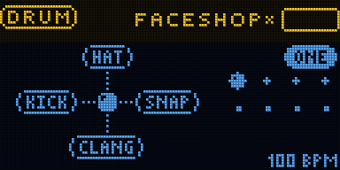
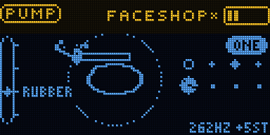

# AIRDWELLER

Two boxes, one in each hand.

AIRDWELLER puts AIR's air drumming and DWELL's pumping into one instrument for two hands. Each box has a role. A DRUM
box is swung like a stick: forward, left, right and back are four pads, and every hit lands on the beat. A PAINT box
holds a material that rings (metal, glass, rubber or latex), struck by the other hand's hits at the same instant and
tuned to its kick; while it rings, tilting it moves to another material, twisting bends the pitch, rolling it changes
the brightness, moving it bows it and shaking it scrapes it. A PUMP box bows that material instead: moving pumps it
up, holding still lets it fall, and the other hand's hits duck it.

So a kick in the left hand can strike a metal plate in the right, and the plate rings on the kick's note. Two DRUM
boxes are one kit split across the hands; two PUMP boxes are a drone you work with both arms. One box alone plays a
mixed kit.

The drums are made from nothing, no samples, after SOPHIE's records (FACESHOPPING, PONYBOY): a rubber kick that
drops into the sub, a latex snap, a metal clang and hat, a glass bell, a sub drop, a whip crack and a creak. SQUEEZE
folds them towards plastic. Hold REC for a loop of whole bars, four stacked; tap REC for a hard stop, and again to
come back in on the next beat.

Firmware for the Samplooler Stack (ESP32-S3). Version 0.1, built 2026-10-25, checked in the host simulator
(`tools/sim`, 138 checks). It has not been on a board. The busiest case (ten drums and the bowed material with every
effect) took 18 microseconds per audio block on a computer that was busy with another build; that is still to be
measured on a quiet computer and on the board. Two boxes playing together have only run in the simulator.

> VIDEO: two boxes, a kick in the left hand striking the metal in the right.

 
 

## Playing it

- **Swing it like a stick.** A short fast turn that stops is a hit. Forward, left, right and back are four pads. The
  hand coming back is not a hit.
- **Hold REC and play.** A loop of whole bars. Up to four, stacked. The stick turns them on and off; hold the knob to
  stop them all.
- **Tap REC.** A hard stop. Tap again: back in on the next beat.
- **Two boxes.** Turn both on: they find each other, share one beat and one key, and decide which is the left hand.
- **PLAY > ROLE.** DRUM, PAINT or PUMP.

The kits:

| Pad | LEFT hand | RIGHT hand | One box |
| - | - | - | - |
| Forward | WHIP | HAT | HAT |
| Left | KICK | CLANG | KICK |
| Right | SNAP | GLASS | SNAP |
| Back | SUB | CREAK | CLANG |

Eleven sounds: FACESHOP, PONY, LATEX, STEEL, GLASSHOUSE, RUBBER ROOM, MECHANICAL ANIMAL, SILICONE, SUB PRESSURE, CHAIN
PUMP, HARD STOPS. Each is a kit, a material and a room, for any role.

[The manual](docs/MANUAL.md) has every setting.

