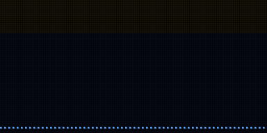
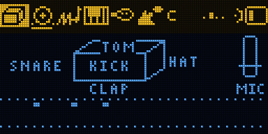

# BAND

A band on one board: DRUMS (knock on the box, or draw a beat on a 4 x 8 grid), BASS, LEAD, KEYS (piano,
electric piano, organ and more), BREATH (an ocarina you blow into) and HOWL (feedback tuned to the chord). Turn
the knob to pick who you play; the others keep playing. Everything is in one key and one tempo and follows the
same chords. Next to a [SING](../sing) the two boards play in time: same tempo, same bars, same chords.

Firmware for the Samplooler's ESP32-S3 boards (the Stack, the Mini, the breadboard kit). It grew out of
[JAM](../jam). It runs on a board but has not been played much yet (see Status).

 

Each layer: [all six](images/band-together.gif), [drums](images/band-drums.gif), [bass](images/band-bass-follow.gif),
[lead](images/band-lead-arp.gif), [keys](images/band-keys-comp.gif) and [their sounds](images/band-keys-sounds.gif),
[breath](images/band-breath.gif), [howl](images/band-howl_layer.gif); [every screen](images/screens.png).

## Playing

1. DRUMS is live first. Hold the knob: the grid opens with a rock beat. Turn to move, press to set a step (press
   again for an accent, again to clear), press and turn to paint a row, hold to close. REC starts and stops the
   beat. Or knock on the box: each side is a drum (DRUMS > KNOCKS: OFF when you only want the grid; knocks are
   never heard while the grid is open).
2. Turn the knob to BASS: after a second it plays along with the chords and keeps playing when you move on.
   Lean the box to change the chord. To write your own line, hold the knob: sixteen steps, turn to move, press to
   set a note (again: a held note, again: off), press and turn to move the note up or down, hold to close. The
   notes count from the chord's root, so the line follows the chords.
3. KEYS: it plays the chords in a rhythm (stabs, offbeats, gospel, bossa...). LEAD: it arpeggiates the chord; or
   hum into the mic and it follows you; or tilt for a note and knock to play it.
4. BREATH: blow at the mic, tilt for the notes. HOWL: tip the box until it howls on the chord.
5. Hold REC on a layer to loop what it plays; the loop is whole bars at the tempo and starts on the beat. Tap REC
   to mute or unmute it. To redo it: tap REC, then hold REC; the new take replaces the old one.
6. Turn the knob past HOWL for the mixer: a fader, a meter and a mute for each layer. Stick left and right picks a
   layer, up and down sets its level; tap REC mutes it, hold REC 1 s erases its loop (2 s: every loop). Without a
   stick, hold the knob there to work it with the knob.

The header: the six layers (the live one lit, a line under each one that loops or plays by itself), the chord,
the four beats of the bar, the link, the level; the row under it is the loop's playhead.

## With a SING

Switch both on. LINK is on by default, in group 1; within a second they find each other ("LINKED: SING") and two
little boards flash on the beat in the header. The radio is ESP-NOW, Espressif's own protocol on the Wi-Fi radio:
no router, no pairing, a few milliseconds per packet.

- BAND keeps the time. Tempo, key, scale and chords go both ways: change them on either board.
- Until there is a loop on either board, the tempo can change; then it stays until every loop is cleared.
- The first loop made anywhere sets the loop's length for both; every loop starts on the same beat.
- When the bass leans to another chord, SING's vocoder and harmonies follow it.
- In the simulator the two boards' beats stay within half a millisecond, with their crystals 25 parts per million
  apart.
- LINK > GROUP keeps two pairs in one room apart. LINK > RANGE lowers the radio's power; NEAR is enough on one
  table.

## Controls

| | |
| - | - |
| turn the knob | pick the live layer; past HOWL, the mixer |
| press the knob | the menu: SONG, each layer's two pages, MIX, FX, LOOPS, LINK, SOUND, SYSTEM |
| hold the knob | on DRUMS: the grid; on BASS: the line; elsewhere: freeze the tilt; in the menu: leave it |
| hold REC | record the live layer's loop, or add to it |
| tap REC | mute / unmute it (DRUMS: stop / start the drums, grid and loop) |
| tap REC, then hold REC | a new take in place of the old one |
| the mixer, or LOOPS (menu) | erase one layer's loop, or all |
| tilt, stick, mic | the live layer's |
| REC held from power-on, 3 s | factory reset |

## Sounds

16 whole-band sounds in SOUND > SOUND: FIRST BAND, ROCK BAND, FUNK BAND, HIP HOP, DUB, LULLABY, ACID SET, RITUAL
DRONE, BLUES BAR, STEEL ISLAND, TECHNO WOLF, TRAP, GLASS GARDEN, INDUSTRY, ANDALUSIA, ZAP ARCADE. Each sets the
song, the grid, the mix, the FX and all six layers. SAVE AS keeps eight of your own (your grid with them).

## MIDI (USB)

DRUMS on channel 10, BREATH on the MIDI channel (SYSTEM > MIDI CH), BASS on the next, HOWL, LEAD and KEYS on the
three after. The settings of DRUMS, BASS, LEAD and KEYS are on CCs (the list is in [docs/MANUAL.md](docs/MANUAL.md));
the rest are not, there are more settings than CCs. Program change picks a sound.

## Build

ESP-IDF v5.5.1:

```sh
. ~/esp/esp-idf/export.sh
cd firmware && idf.py build
../tools/flash.sh          # finds the board by name, never touches a TWOFOLD
```

`tools/sim/run.sh` runs the simulator and writes screens, animations and sound to `tools/sim/out/`.

## Status

Runs on a board (2026-10-15): about 45 % of the CPU idle, about 55 % with the grid, the bass, the keys and the lead
all playing (peaks near 80 %), no dropouts. Not played much yet, and the link has not met a SING on real radio yet.
285 checks in the simulator. The log (`python3 tools/sl_midi.py log`) shows each layer's cost.
