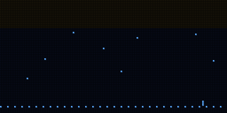
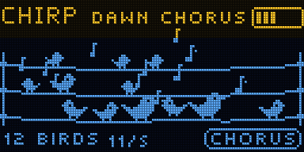
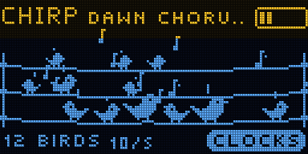
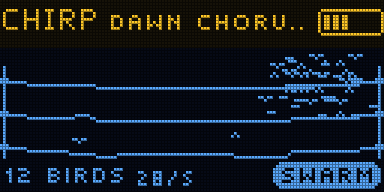
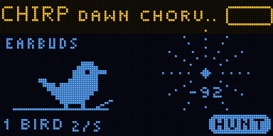

# CHIRP

The Bluetooth devices around you, played as birds.

Phones, earbuds, watches, trackers and beacons send a short Bluetooth message several times a second
whether anyone is listening or not. CHIRP listens. Each device it hears becomes a bird on one of three
wires (Bluetooth sends these messages on three channels). The bird sings a call that fits the kind of
device, in a scale, as near or far as the signal is strong. Walk around and the chorus changes.

It runs on the Samplooler's ESP32-S3 boards (the Stack, the Mini or the breadboard kit).

**Status:** not yet run on hardware. Everything here was checked in the host simulator (`tools/sim`).




## Playing

Switch it on. Birds fly in as devices are heard; each says hello once.

| | |
| - | - |
| turn the knob | another sound (14 of them) |
| tip the bottom edge down | longer calls |
| lean left or right | the birds move up or down the scale |
| stick left / right | pick a bird: it gets louder, and HUNT follows it |
| stick up / down | brighter or darker |
| hold REC | record a loop of what you hear; hold again to add to it; tap to stop or play it |
| press the knob | the menu; hold the knob to come back |
| hold the knob while playing | hold the tilt where it is (a padlock shows); again to let go |

Tips at the bottom of the screen show the rest the first few times.

## Four ways to hear the crowd

- **CHORUS**: devices sing when they send, in short phrases with rests, like birds at dawn.
- **CLOCKS**: each bird pulses at its device's own rhythm, slowed down. Many devices make a polyrhythm;
  with QUANTIZE on, the pulses snap to a tempo.
- **SWARM**: every message is a grain. The birds lift off as a flock and the sound becomes a flutter
  that thickens with the traffic.
- **HUNT**: follow one device like a Geiger counter. The ticks speed up and rise as you get nearer.
  It shows NEARER or FARTHER as you walk.

  

## Sounds

| | |
| - | - |
| DAWN CHORUS | each kind of device with its own call, D major pentatonic |
| CLOCK SHOP | every device a ticking pip at its own pace |
| DRUM CIRCLE | water drops on a grid at 100 BPM, with swing |
| GAMELAN | bells in pelog, quantized |
| NIGHT FOREST | few, low, far away, in a big space |
| AVIARY | a crowd of trills |
| STARLINGS | a swarm over the wind |
| PEBBLE RAIN | a swarm of drops |
| PIGEON SQUARE | coos |
| MORSE | fast pips |
| WATER GARDEN | drops in a pentatonic, with room |
| SLOW MOTION | long, sweeping calls, hirajoshi |
| WARBLERS | warbles in lydian |
| GEIGER | HUNT |

Your own: SOUND > SAVE AS keeps up to eight.

## Who sings what

The kind of device is a guess from what its messages say about themselves (the maker, the services it
offers, its stated appearance). It only chooses the bird.

| Device | Call | Register |
| - | - | - |
| phone | chirp: a quick rising sweep | middle |
| earbuds, headphones | whistle | middle |
| watch, fitness band | trill | high |
| tracker (AirTag, Tile, SmartTag) | pips | high |
| beacon | bell | middle |
| laptop, keyboard | warble | low |
| speaker, TV | coo | low |
| anything else | a chirp, whistle or warble | middle |

## MIDI

Over USB, on the channel set in SYSTEM > MIDI CH:

- out: a note for every call (velocity: how near), CC 3 the number of birds (x5), CC 9 calls per second,
  every setting as CC 20 and up, program change on a sound change, CC 12-15 tilt and stick.
- MIDI SPLIT > BY KIND puts each kind of device on its own channel (phones on the base channel,
  earbuds on the next, and so on).
- in: notes play a call at that pitch (MIDI KEYS), CC 20 and up set the settings, program change picks a
  sound, note 60 or the sustain pedal (CC 64) is REC.

## Privacy

CHIRP only listens. From each message it keeps a hash of the sender's address salted with a number
drawn fresh at every start, the signal strength and a guess at the kind of device. It does not keep or
show addresses, names or what the messages contain, has no network and stores nothing about the
devices. Phones change their Bluetooth address every few minutes so they cannot be followed; to CHIRP
that looks like a bird flying off and a new one arriving.

## Build and flash

ESP-IDF v5.5.1:

```sh
. ~/esp/esp-idf/export.sh
cd firmware
idf.py build
../tools/flash.sh      # finds the board by name over USB and flashes it; never touches anything else
```

Same flash layout as the Samplooler: its saved loops stay where they are.

## Simulator

`tools/sim/run.sh` builds the instrument on the computer with a pretend crowd of devices that send real
Bluetooth payloads, and runs 61 checks: the menu, the sounds, the looper, no clicks, the parser, the
rhythm estimates, the grid, HUNT, the controls. It writes the screens to `tools/sim/out/chirp.png`,
the animations as GIFs and the sound as WAV files.

## First things to check on hardware

- How many devices a real room shows, and how often the scan catches each one.
- The categories against real phones, earbuds and trackers.
- RSSI on the real antenna: set NEAR AT and FAR AT to match.
- CPU and free memory with Bluetooth, USB and the reverb running (SYSTEM > ABOUT).
