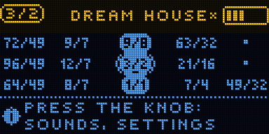
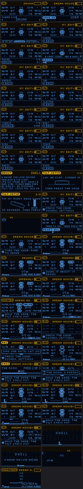

# DWELL

A drone you live inside.

DWELL holds a chord of whole-number ratios on one low note, the way La Monte Young tunes the Dream House. Tilt the
box and you walk a lattice of those ratios: away from you up the fifths (3/2, 9/8, 27/16), towards you down them
(4/3, 16/9), roll it for the sevenths (7/4, 7/6, 21/16). The tones you pass stay behind you, up to six, the oldest
giving way. Nothing happens fast: a change takes twenty seconds to arrive (DRIFT), by a swell or a slide, as in
Eliane Radigue's music. Turn the knob and each tone becomes a cluster of copies a few cents apart, beating slowly,
louder and brighter, until it is a wall: Phill Niblock. Sing one note into it and the box stacks your own voice. Run a ROOM PASS and it plays itself through the speaker into the room,
records that, plays the recording, records again, until only the room's own resonances are left, which is what Alvin
Lucier did with his voice in 1969.

Move it and it grows. Swinging, turning or waving the box pumps energy into the drone, and the energy falls back
slowly when you hold still, so gesture after gesture builds a crescendo: from a quiet floor, through thicker clusters
and an overdrive that drags out more overtones, into a wall, as Kevin Drumm's records do. Shake it and it throws grit,
faster beating and a surge of echo. Knock once on the box and the whole drone fades over onto the next fundamental.
The voices then go through an overdrive, an echo and a hall, each with its own wet and dry. Optionally the Wi-Fi and
Bluetooth traffic around you crackles into it, as a phone does near a speaker.

Eight sources: sines, a harmonium reed, a bowed string, a tanpura whose curved bridge buzzes so its overtones bloom
after each pluck, a shruti box with its bellows, a hurdy-gurdy with the wheel's rumble, your own tone, and the room.

Firmware for the Samplooler Stack (ESP32-S3). Version 0.2, built 2026-10-24, checked in the host simulator
(`tools/sim`, 191 checks). Version 0.1 started on a board (13 % of the processor on the first sound) and its drones
were heard; 0.2 (the energy, the shake, the knock's new root, the overdrive, the echo, the radios) has not been on a
board yet. Its busiest case takes 12 to 13 microseconds per audio block on a computer, which should be about 45 % of
the board's processor; that is still to be measured, as is the memory with Bluetooth on.

> VIDEO: DWELL on a table, tilted one step every half minute, the room pass.

 

## Playing

1. Switch it on. Two tones: 1/1 and the same an octave under it (the root). The screen shows the lattice with 1/1 lit
   and a figure lying on the floor, listening.
2. Tip the box away from you, about ten degrees, and put it down. After a moment 3/2 lights, and over twenty seconds
   it swells in. 1/1 stays. Tip it further: 9/8. Roll it right: 21/16. The screen prints the ratio, how far it is
   from the piano's note in cents, and the beat rate.
3. Pick it up and swing it, turn it, wave it about. It grows: louder, thicker, dirtier. Keep moving and it keeps
   growing, about eight seconds to the top (ENERGY > CLIMB). Hold still and it sinks back over twenty (FALL). The bar
   along the bottom of the screen is the energy; the figure sits up as it climbs. While you swing, the lattice does not
   move; where the box comes to rest, the lead goes.
4. Shake it hard: grit in the overdrive, the copies beating fast, the echo surging. It settles in a second or two.
5. Knock once on the box, held still: the whole drone fades over onto a new fundamental (TAP > NEXT ROOT: the note
   you lean towards, a fifth up when level), over eight seconds (FADE). TAP > HOME fades back to the key.
6. Turn the knob: DENSE, the clusters' floor, whatever the energy adds on top.
7. Hold REC and sing one steady note. Let go. The source turns to WAVE: that note, stacked on the lattice.
8. Press the knob, ROOM > ROOM PASS. Let it run (twelve passes of four seconds). The room sings back through the
   lattice afterwards (the source turns to ROOM). It needs the speaker on and a room; on headphones it stops by itself.
9. Tap REC: the drone rests. Tap again: it returns.
10. RADIO > RADIO: WI-FI, BLUETOOTH or BOTH. Every frame the antenna hears crackles into the overdrive and chops the
    drone; a router's beacons tick ten times a second, a phone's traffic bursts, Bluetooth adverts buzz. INTERFERE sets
    how hard. Nothing about who sent them is read or kept. With the link on, DWELL listens on the link's own channel.

## Controls

| | |
| - | - |
| tip away / towards you | up / down the fifths |
| roll right / left | up / down the sevenths (the fifths' thirds with LIMIT 5; nothing with LIMIT 3) |
| swing, turn, wave it | energy: it grows; still, it falls back |
| shake it | grit, fast beating, the echo surging |
| knock once | the next fundamental fades in (or a strum: TAP > KNOCK) |
| turn the knob | DENSE: pure sines to a beating wall |
| press the knob | the menu: SOUND, DRONE, ENERGY, TAP, LATTICE, CLUSTER, SOURCE, DIRT, ECHO, SPACE, RADIO, ROOM, SONG, SYSTEM |
| press the knob twice | the knob turns the volume for a moment |
| hold the knob | the tilt stays where it is (a padlock shows); hold again to let go |
| hold REC | sing one note: it becomes the WAVE source |
| tap REC | the drone rests; tap again, it returns (and it stops a room pass) |
| stick up / down | the lead an octave up / down |
| stick left / right | the chord louder / the lead louder |

## Sounds

DREAM HOUSE (pure sines, 7-limit), DRUMM (from near silence into a bowed, driven wall, slow to build and slower to
fall), MIASMA (a hurdy-gurdy, harsh from the start, shaking throws it to pieces), IMPERIAL (a quiet reed with a long
echo, barely driven), BOWED BY HAND (it sounds only while you move it), NIBLOCK (a bowed wall, eight copies), ADNOS (a slow glide on a reed), IN A ROOM
(the room source: run ROOM PASS first), TANPURA, SHRUTI BOX, HURDY GURDY, STRUMMING (long strums on sines),
CONRAD (a bow in 5-limit), DAVACHI (a six-voice organ that slides), DEEP LISTENING (a reed in a long hall),
INTERFERENCE (both radios cutting in), TEMPO BEATS (the clusters beat at the flock's tempo, the echo on the beat), YOUR TONE (the WAVE source), TARTINI (two tones and their
difference tone), PYTHAGORAS (3-limit). Eight more places for your own, under SOUND > SAVE AS.

## With other boards

On the radio link DWELL shares the tempo and the key with a BAND, a SING, the Samplooler or another DWELL. SONG >
FOLLOW: a chord played live on a linked board moves 1/1 to the nearest ratio of the lattice, at DRIFT. SONG > SPREAD:
with another DWELL in the room, each board sounds one tone of its own chord, so a few boards around a room are one
chord you can walk through. CLUSTER > BEAT SYNC: the copies beat at the tempo (120 BPM is 2 Hz).



## Build

ESP-IDF v5.5.1:

```sh
. ~/esp/esp-idf/export.sh
cd firmware && idf.py build
../tools/flash.sh          # finds the board by name, never touches a TWOFOLD
```

`tools/sim/run.sh` runs the simulator and writes screens, animations and sound to `tools/sim/out/`.
[docs/MANUAL.md](docs/MANUAL.md) has every setting.
