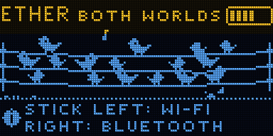
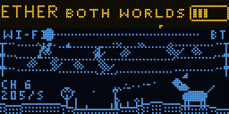
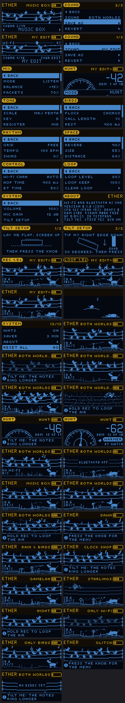

# ETHER

The Wi-Fi and the Bluetooth around you, heard together as one piece of music. Firmware for the
Samplooler boards (the Stack, the Mini, the breadboard kit: ESP32-S3).

On the ground, the Wi-Fi: every device that sends a frame plays its own note, routers ring like bells,
and a soft chord follows the room itself, swelling when someone walks past the router. A microwave
oven makes a storm. In the air, the Bluetooth: every phone, watch, earbud and tracker that advertises
is a bird on a wire, singing in short phrases. Both share one key, one tempo and one hall. Lean the
joystick left for more Wi-Fi, right for more Bluetooth. HUNT finds a device from either radio by ear.

It is SNIFF and CHIRP at the same time, with both radios listening at once.

**Status:** runs on a board. On 2026-10-14 both radios listened at once and it played what it heard,
using 44 % of the CPU (65 % at the busiest moment) with no dropouts and 57 KB of internal memory to spare.
Not played much yet. The rest was checked in the host simulator (`tools/sim`, 88 checks), which makes up a
flat full of Wi-Fi devices and a room full of Bluetooth ones. How much each radio misses while the other
listens is still to find out.

 

## Playing

1. Switch it on. Birds land on the wires as Bluetooth devices are heard; for a few seconds the Wi-Fi
   listens to every channel (SCAN, bottom left), then stays on the busiest one.
2. Push the joystick left and right: the music moves between the Wi-Fi and the Bluetooth (the other
   world greys out on the screen).
3. Turn the knob for another sound. The first, BOTH WORLDS, has everything.
4. Walk past your router: the chord swells and the ground ripples. When a bird near you sings, the
   dog looks up.
5. Turn to HUNT and walk around: the needle and the beeping say whether you are getting closer. Flick
   the joystick to hunt another device; the screen says whether it is Wi-Fi or Bluetooth.
6. Hold REC to loop what you hear; hold again to add, tap to stop or start the loop.

| Control | Does |
| - | - |
| turn the knob | next or previous sound |
| press the knob | the menu (press to go in, press again to come back; hold to leave) |
| hold the knob | hold the tilt where it is; again to let go |
| REC | hold: record a loop or add to it; tap: stop / play the loop |
| joystick left / right | more Wi-Fi / more Bluetooth; in HUNT, the next device |
| joystick up / down | up: hear only what is near; down: hear everything |
| tilt, bottom edge down | notes ring longer, calls get longer |
| lean left / right | walk the notes up and down the scale |

What tilt, lean and the joystick do can be changed under CONTROL in the menu.

## The screen

The sky is Bluetooth: three wires (Bluetooth advertises on three channels) and a bird for each device,
bigger the nearer, with a note when it calls. The ground is Wi-Fi: its shape is the room's radio shape,
each reed a device (a router's has an antenna), taller the nearer, flashing when it sends. The dog
sniffs the reeds, looks up at loud birds, pricks its ears when the room moves, hides from the storm.
Bottom left: the Wi-Fi channel and frames a second.

## Sounds

| | |
| - | - |
| BOTH WORLDS | everything: plucks and bells on the ground, birds in the air, the room's chord |
| MUSIC BOX | kalimba frames and bell-voiced birds pulsing at their own rates, on a 1/16 grid |
| DAWN | leaning to the birds, with drops for the Wi-Fi |
| RAIN & BIRDS | every frame a raindrop, birds singing through it |
| CLOCK SHOP | each bird ticks at its own advertising interval, Wi-Fi plucks on the grid |
| GAMELAN | slow bells and pulses in a pelog scale |
| GHOSTS | the room's chord, a few quiet birds |
| STARLINGS | the Bluetooth crowd as a flutter, Wi-Fi drops below |
| NIGHT | low, slow, wide; leaning to the Wi-Fi |
| STORM | the interference, birds and static |
| HUNT | find one device by ear |
| ONLY WI-FI | SNIFF's side alone |
| ONLY BIRDS | CHIRP's side alone |
| GLITCH | static and chirps on a fast grid, with echoes |

Change anything and the sound becomes MY EDIT; SOUND > SAVE AS keeps up to eight of your own.
[docs/MANUAL.md](docs/MANUAL.md) explains every setting.

## Privacy

ETHER only listens: it never joins a network, connects to a device or sends anything over the air.
From either radio it keeps the kind of frame or advertisement, its signal strength, the Wi-Fi channel,
a rough guess at what kind of Bluetooth device it is (from what the advertisement says it is), and a
number made from the sender's address mixed with a random value that changes every time it starts. No
address, name, network or content is kept, shown or sent anywhere.

## MIDI

Over USB. Wi-Fi notes go out on the MIDI channel (SYSTEM > MIDI CH), bird calls on the next one, louder
for nearer devices. CC 3 Wi-Fi frames a second, 4 room movement, 5 storm, 6 HUNT nearness, 8 birds,
9 bird calls a second; 12/13 the tilt, 14/15 the joystick. Every setting is on CC 20 onwards, both ways
(the list is in the manual). A note in sets the key. Program change picks a sound.

## Building

ESP-IDF v5.5.1, as for the Samplooler:

```sh
. ~/esp/esp-idf/export.sh
cd firmware && idf.py build
../tools/flash.sh          # finds the board by name over USB and flashes only that one
tools/sim/run.sh           # the simulator: screens, animations and sound in tools/sim/out/
```


