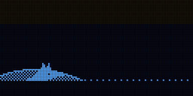
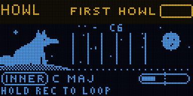
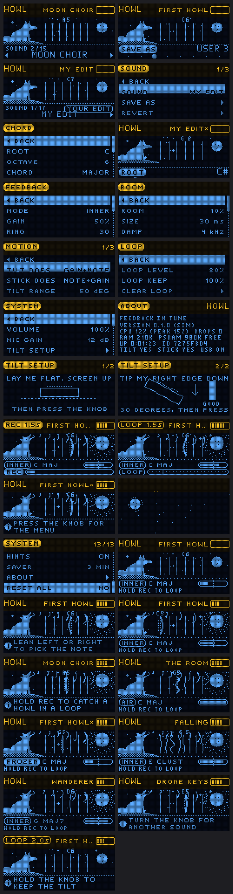

# HOWL

Feedback in tune. The box listens through its mic and plays what it hears through a bank of narrow
filters tuned to a chord, so only the chord's notes can build up into a howl. Tip it to bring the howl
in, lean to choose which note sings.

 

Status: not yet run on hardware. Everything here was checked in the host simulator (`tools/sim`).

## Playing

1. Hold the box with the screen towards you. Flat, it is quiet.
2. Tip the bottom edge down. Somewhere past 10 degrees a note starts to howl.
3. Lean left or right: the howl moves to a lower or higher note of the chord.
4. Turn the knob for another sound.
5. Hold REC to catch the howl in a loop; hold it again to add another layer. Tap REC to stop or start it.

A howl settles at HOWL LEVEL (FEEDBACK page) and never goes more than 2 dB over it, whatever you do. INNER sounds work on
headphones. AIR sounds need the speaker: the howl goes through the room, and moving the box or your
hand around it changes which notes come.

## Controls

| | |
| - | - |
| tip (bottom edge down) | gain: how close to howling |
| lean left / right | which note of the chord leads |
| joystick | x: which note, y: swell (STICK DOES on the MOTION page changes this) |
| turn | change the sound, or the setting you last edited in the menu |
| press the knob | menu |
| hold the knob | hold the tilt where it is (a padlock shows); again to let go |
| REC | hold: record or add to the loop; tap: stop / play |
| REC held at power-on | reset everything to new (the tilt setup is kept) |

## Sounds

| | |
| - | - |
| FIRST HOWL | C major, a plain clean howl: start here |
| MOON CHOIR | A minor, wide apart, slowly beating, a small room |
| GLASS | the overtones of D, very narrow |
| SHEPARD | a whole-tone howl that climbs for ever |
| FALLING | a cluster that keeps falling |
| CATHEDRAL | F major 7 in a long, dark room |
| WOLF PACK | D sus4, detuned so the voices beat, a warm grain |
| FURNACE | a cluster driven hard |
| TIDE POOL | whole tone, breathing in and out by itself |
| HIRAJOSHI | the Japanese scale, wandering slowly |
| WANDERER | the chord moves on by itself every few seconds |
| SIREN | fifths through a fast shifting room, folded |
| THE ROOM | AIR: the real loop through the speaker and the room |
| AIR CHOIR | the speaker and the inner loop together |
| DRONE KEYS | fifths, made to be played from a MIDI keyboard |

`docs/MANUAL.md` explains every setting.

## MIDI (USB, channel set in SYSTEM > MIDI CH)

| | |
| - | - |
| out: note | the note that is howling (note off when it stops) |
| out: CC 11 | how hard it howls, 0..127 |
| out: CC 12 / 13 | lean (tip, side), CC 14 / 15 joystick x / y (SYSTEM > MIDI CC OUT) |
| out: program change | the sound changed |
| in: notes | with MIDI KEYS on HOLD or LATCH, the notes you hold become the chord |
| in: CC 64 (sustain pedal) | REC |
| in: CC 123 | forget the held notes |
| both: CC 20..49 | every setting, in the order of the menu (ROOT 20 ... TILT RANGE 49) |
| in: program change | choose a sound |

## Building and flashing

ESP-IDF v5.5.1:

```sh
. ~/esp/esp-idf/export.sh
cd firmware && idf.py build
../tools/flash.sh        # finds the board by name over USB, never a TWOFOLD
```

The flash layout is the Samplooler's; the flash script writes only the bootloader, the partition table
and the app, so the Samplooler's saved loops stay.

## Simulator

`tools/sim/run.sh` runs HOWL on the computer: 64 checks (the menu, the sounds, the looper, no clicks,
the level ceiling with a speaker four times too loud, the howl landing on the chord's notes, leaning,
the joystick, freeze, the climbing shift, MIDI), screens in `tools/sim/out/howl.png`, animations as GIFs,
the sound as WAV.


