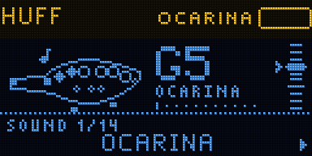

# HUFF

A wind instrument for the Samplooler boards. Blow at the mic and it plays; tilt the box to change the note.
Seven models: ocarina, flute, pan pipe, shakuhachi, clarinet, tin whistle and a blown bottle.

Not yet run on hardware. Everything here was checked in the host simulator (`tools/sim`) only.

 

## Playing

1. Switch it on and blow gently across the mic, as if into a flute.
2. Tilt the bottom edge down for higher notes, up for lower. The ladder on the right shows where you are.
3. Blow harder for louder. On the flutes and the clarinet, blow much harder and the note jumps up.
4. Turn the knob for another sound.
5. Hold REC to record a phrase. Let go and it loops, then play over it.

If it plays too easily or not at all, run BREATH SETUP (menu > BREATH): stay quiet for two seconds, then
blow normally for three.

## Controls

| | |
| - | - |
| blow | play; harder is louder |
| tilt (bottom edge down / up) | higher / lower note |
| lean left or right | vibrato (or a bend, see PITCH > LEAN DOES) |
| joystick left / right | bend the note (2 semitones; PITCH > BEND RANGE) |
| joystick up | more vibrato (PITCH > STICK UP/DN: or brightness, or octaves) |
| turn the knob | next or previous sound |
| press the knob | menu |
| hold the knob | keep the current note while you move (the tilt is held); again to let go |
| REC | hold: record or add to the loop; tap: stop or play it |

## Sounds

OCARINA, FLUTE, SHAKUHACHI, PAN PIPES, CLARINET, TIN WHISTLE, BOTTLE, CAVE (ocarina in a big echoing
space), TWIN OCARINA (with a third above), DESERT (flute, Hijaz scale, echo), DRONE PIPES (pan pipe over a
drone), THEREMIN (flute that slides between notes), HUM ALONG (the ocarina follows the note you hum),
BLUES REED (clarinet, blues scale). Eight more places for your own, under SOUND > SAVE AS.

## MIDI (USB)

| Out | |
| - | - |
| notes | the note you play, velocity from the breath |
| CC 2 | breath |
| pitch bend | the joystick's bend (full scale = BEND RANGE) |
| CC 20 and up | every setting, when you change it |
| program change | the sound |

| In | |
| - | - |
| notes | set the pitch while held: play the keys and blow |
| CC 2 | breath, for a breath controller (or play without blowing) |
| pitch bend | bend |
| CC 20 and up, program change | settings, sounds |
| CC 64 (sustain pedal) | REC: hold to record or add to a loop |

All on the MIDI channel set in SYSTEM (1 by default). Note 60 does not start the looper here, because
HUFF plays incoming notes; the sustain pedal does.

## Building

ESP-IDF v5.5.1, as for the Samplooler:

```sh
. ~/esp/esp-idf/export.sh
cd firmware && idf.py build
../tools/flash.sh          # finds the board by name over USB and flashes only that one
../tools/sim/run.sh        # the simulator: every check, screens, GIFs and sound in tools/sim/out/
```

The full manual is [docs/MANUAL.md](docs/MANUAL.md). All the screens: [images/screens.png](images/screens.png).
