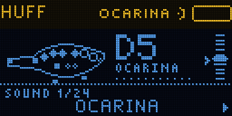
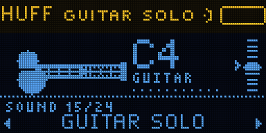

# HUFF

A wind instrument for the Samplooler boards. Blow at the mic and it plays; tilt the box to change the note.
Thirteen models: ocarina, flute, pan pipe, shakuhachi, clarinet, tin whistle, a blown bottle, trumpet, trombone,
didgeridoo, a guitar you blow into life, a synth lead and a choir. An amp with drive sits behind them all, for solos.

Installed from the desktop app and run on a board on 2026-10-19, and played a little: it was too easy to set off.
The breath detector was reworked on 2026-10-22 for noisy rooms, with the six new models, the amp and the deeper
range; checked in the host simulator (`tools/sim`, 126 checks) and on a board the same day, where the breath's
real levels set the defaults. Not played much yet.

Rev E of the board (the Vessel) has no joystick. It has a second knob on the left and a sensor that measures how
high a hand is held over the board. Since 2026-11-16 HUFF uses both: the left knob is the octave, the hand is a
mute. This is tested in the simulator only. No rev E board has run it.

  

## Playing

1. Switch it on and blow gently across the mic, as if into a flute.
2. Tilt the bottom edge down for higher notes, up for lower. The ladder on the right shows where you are.
3. Blow harder for louder. On the flutes, the clarinet, the brass and the synth, blow much harder and the note jumps up.
4. Turn the knob for another sound. GUITAR SOLO and SYNTH SOLO are made for leads: lean to bend, the amp on.
5. Hold REC to record a phrase. Let go and it loops, then play over it.

Run BREATH SETUP first (menu > BREATH): stay quiet for two seconds, then blow normally for three. It learns how
loud your breath is and what it sounds like against the room, and that is what keeps HUFF quiet when people talk
or music plays. If it still plays too easily, turn BREATH > GATE or ROOM NOISE up. If the speaker keeps it
sounding on its own, turn SYSTEM > SPEAKER off and use the line out or headphones.

## In a noisy room

HUFF listens for wind, not for sound. A soft breath on the mic is low rumble with little middle; voices and music
have a middle. A sound quieter than half a breath only counts as breath while its low band stands over its middle
(the ratio BREATH SETUP learned; BREATH > ROOM NOISE sets how strictly it is asked) and once it has kept coming
for a moment; anything that rumbles like half a breath at the mouth is one. The room's own level is taken off the
breath before it is measured, so a breath over noise keeps its dynamics instead of being gated to all or nothing,
and a room that keeps the gate open at a whisper is learned as the room. The thresholds come from a board on
2026-10-22 (a breath's low band reads 0.1 soft to 1.8 hard on this mic); the noise rejection itself is from the
simulator's pretend room (a bass line, chords, a kick on every beat, someone talking) and has not met a real one
yet. A kick drum alone can still give a whisper.

## Controls

| | |
| - | - |
| blow | play; harder is louder (the guitar: harder is more sustain) |
| tilt (bottom edge down / up) | higher / lower note (PITCH > TILT SPAN up to 180 degrees, PLAY > NOTES up to 24) |
| lean left or right | vibrato (or a bend, see PITCH > LEAN DOES) |
| joystick left / right (boards with a joystick) | bend the note (2 semitones; PITCH > BEND RANGE) |
| joystick up (boards with a joystick) | more vibrato (PITCH > STICK UP/DN: or brightness, or octaves) |
| left knob (rev E) | the octave: one click is one octave, from two down to two up. It is PLAY > OCTAVE, and it stays where you leave it |
| a hand over the sensor (rev E) | a mute, like a hand over a trumpet's bell: the lower the hand, the darker and quieter. Fully down (4 cm) it is muffled, not silent. Wave the hand for a wah. PITCH > HAND DOES can make it vibrato or a bend instead |
| turn the knob | next or previous sound |
| press the knob | menu |
| press the knob twice | the knob turns the volume, until it rests 3 s or you press it again |
| hold the knob | keep the current note while you move (the tilt is held); again to let go |
| REC (rev E: push the left knob) | hold: record or add to the loop; tap: stop or play it |

Rev E's two controls are tested in the simulator only. They have run on no board. What a rev E cannot do that a
board with a joystick can is listed in the manual ("Rev E").

## With other boards

HUFF links to the other instruments of this library over the air (LINK in the menu, on by default). Boards in
the same group share a key, a scale and a tempo: change KEY or SCALE here and the others follow, as theirs
change HUFF's; the echo can repeat on the shared beat (SPACE > ECHO BEATS). HUFF's own scales (the
pentatonics, Hijaz, blues, In Sen) stay as they are while the flock is on the scale their notes sit in.

## Sounds

OCARINA, FLUTE, SHAKUHACHI, PAN PIPES, CLARINET, TIN WHISTLE, BOTTLE, CAVE (ocarina in a big echoing
space), TWIN OCARINA (with a third above), DESERT (flute, Hijaz scale, echo), DRONE PIPES (pan pipe over a
drone), THEREMIN (flute that slides between notes), HUM ALONG (the ocarina follows the note you hum),
BLUES REED (clarinet, blues scale), GUITAR SOLO (the guitar through a driven amp, minor pentatonic, lean to
bend), CLEAN GUITAR, POWER CHORD (guitar with a fifth, two octaves down, the amp on full), SYNTH SOLO (the lead,
a little drive and echo), ACID LEAD (the lead sliding between notes, driven), TRUMPET, TROMBONE, DIDGERIDOO (a
drone in D with a mouth that opens with the breath), CHOIR (with a third above), DEEP CHOIR (two octaves down over
a drone). Eight more places for your own, under SOUND > SAVE AS.

## The models

| | |
| - | - |
| OCARINA, BOTTLE | a blown vessel: a sine with a little air rung through it |
| FLUTE, PAN PIPE, SHAKUHACHI, WHISTLE | an air jet across a pipe (the STK flute); blown hard it jumps an octave |
| CLARINET | a reed on a half-length bore; blown hard it jumps a twelfth |
| TRUMPET, TROMBONE, DIDGERIDOO | a lip buzzing into a long bore (the STK brass); blown hard the lip tightens an octave. The didgeridoo plays three octaves down with a vocal formant the breath opens |
| GUITAR | a string, plucked when a note starts and fed by the breath while it lasts; held, it swells and sings like a guitar on a sustainer; let go, it rings out. An octave down |
| SYNTH LEAD | two saws a little apart and a sub octave through a resonant low pass the breath opens |
| CHOIR | a voice: a glottal pulse through three formants, from OO to AH as the breath grows |

TONE > DRIVE is the amp behind all of them: clean at 0, a fuzz at 100, with a cabinet's low pass. PLAY > OCTAVE goes
four octaves down, so anything can be a bass.

## MIDI (USB)

| Out | |
| - | - |
| notes | the note you play, velocity from the breath |
| CC 2 | breath |
| pitch bend | the bend from the joystick, the lean or the hand (full scale = BEND RANGE) |
| CC 20 and up | every setting, when you change it (the link's switches excepted) |
| program change | the sound |

| In | |
| - | - |
| notes | set the pitch while held: play the keys and blow |
| CC 2 | breath, for a breath controller (or play without blowing) |
| pitch bend | bend |
| CC 20 and up, program change | settings, sounds |
| CC 64 (sustain pedal) | REC: hold to record or add to a loop |

All on the MIDI channel set in SYSTEM (1 by default). Note 60 does not start the looper here, because
HUFF plays incoming notes; the sustain pedal does.

## Building

ESP-IDF v5.5.1, as for the Samplooler (the core's files are copied in from `core/`, 2026-10-19):

```sh
. ~/esp/esp-idf/export.sh
cd firmware && idf.py build
../tools/flash.sh          # finds the board by name over USB and flashes only that one
../tools/sim/run.sh        # the simulator: every check, screens, GIFs and sound in tools/sim/out/
```

The full manual is [docs/MANUAL.md](docs/MANUAL.md). All the screens: [images/screens.png](images/screens.png).
