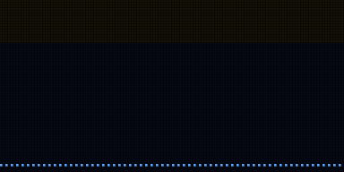
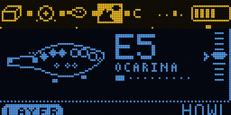

# JAM

Four instruments in one box, looped on top of each other: DRUMS (knock on the box), BASS, BREATH (blow at
the mic) and HOWL (tuned feedback). Turn the knob to pick one; hold REC to loop it; the first loop sets the
tempo, and everything plays in the same key and follows the same chords.

Firmware for the Samplooler's ESP32-S3 boards (the Stack, the Mini, the breadboard kit). It runs on a board
(see Status) but has not been played much yet; the rest was checked in the simulator (`tools/sim`).

 

Each layer: [drums](images/jam-drums.gif), [the drums' stick](images/jam-drums-stick.gif), [bass](images/jam-bass-follow.gif),
[breath](images/jam-breath.gif), [howl](images/jam-howl_layer.gif); [every screen](images/screens.png).

## Playing

1. DRUMS is live first: knock on the box (each side is a different drum). Hold REC while you knock, let go: a loop.
   That sets the tempo.
2. Turn the knob to BASS: it already plays along with the chords; lean the box to change them. Hold REC to keep what
   it plays.
3. Turn to BREATH: blow at the mic, tilt for the notes. Hold REC to record a phrase into the loop.
4. Turn to HOWL: tip the bottom edge down until it howls on the chord. Hold REC to record it.
5. Tap REC to mute or unmute the live layer's loop. Press the knob for the menu.

## Controls

| | |
| - | - |
| turn the knob | pick the live layer |
| press the knob | the menu |
| hold the knob | leave the menu; outside it, freeze the tilt |
| hold REC | record (or add to) the live layer's loop |
| tap REC | mute / unmute it |
| tilt, stick, mic | the live layer's |

The header shows the four layers (the live one lit), which have loops, the chord, the beat and the level.

## Sounds

13 whole-jam sounds in SOUND > SOUND: FIRST JAM, FUNK BAND, DUB, LULLABY, ACID SET, RITUAL DRONE, BLUES BAR,
STEEL ISLAND, TECHNO WOLF, GLASS GARDEN, INDUSTRY, ANDALUSIA, ZAP ARCADE. Each sets the song, the mix, the FX
and all four layers. SAVE AS keeps eight of your own.

## MIDI (USB)

DRUMS on channel 10, BREATH on the MIDI channel (SYSTEM > MIDI CH), BASS on the next, HOWL on the one after.
Every setting is on a CC; program change picks a sound. The list is in [docs/MANUAL.md](docs/MANUAL.md).

## Build

ESP-IDF v5.5.1:

```sh
. ~/esp/esp-idf/export.sh
cd firmware && idf.py build
../tools/flash.sh          # finds the board by name, never touches a TWOFOLD
```

`tools/sim/run.sh` runs the simulator and writes screens, animations and sound to `tools/sim/out/`.

## Status

Runs on a board: on 2026-10-14 it used 48 % of the CPU (66 % at the busiest moment) with no dropouts.
Not played much yet. The simulator checks the song, the loops and tracks, the mixer and FX, every layer's
own behaviour, clicks, levels and cost: 128 checks. Things only playing it can tell: whether the
accelerometer finds the knocked side on a real box, and how the mic hears breath, knocks and the speaker.

[docs/MANUAL.md](docs/MANUAL.md) explains every layer and setting. [docs/CORE.md](docs/CORE.md) is the core
shared with KNOCK, HUFF and HOWL.
