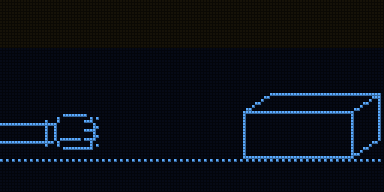
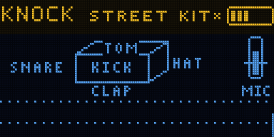

# KNOCK

Knock on the box to play drums. Each side is its own drum: the screen, the left and right sides, the
top and bottom edges. Hold REC while you knock and it loops.

Firmware for the Samplooler's ESP32-S3 boards (the Stack, the Mini, the breadboard kit). It has not run
on hardware yet: everything below was checked in the simulator (`tools/sim`).

 

More: [the stick's roll and repeat](images/knock-stick.gif), [the marimba, a note per side](images/knock-marimba.gif),
[every screen](images/screens.png).

## Playing

- Knock on the box with a knuckle. The mic hears when and how hard, the motion sensor feels which side.
- Turn the knob for another kit.
- Hold REC while you knock. Let go and what you played loops. Hold REC again to add to it; tap REC to
  stop it or start it again.
- Push the stick up for a drum roll of the last drum, down to repeat the last bit of the beat; left and
  right is a filter.
- Tilt it: the bottom edge down tunes the drums up. Leaning it sideways makes the loop change as it plays.
- With SCRATCH BOX, rub or scrape the box: the glass rings for as long as you rub.
- Press the knob for the menu. Hold the knob to leave it. Outside the menu, holding the knob freezes the
  tilt where it is (a padlock shows); hold again to let go.

The first time it starts it asks to set the tilt: lay it flat and press, tip the right edge down and press.

## Sounds

| | |
| - | - |
| STREET KIT | kick, snare, hat, tom, clap, and a little wood ringing under each knock |
| 808 PARTY | long kick, clap, hat, cowbell, open hat, some dirt |
| MARIMBA | no drums: each side is a marimba note (C D E G A) |
| BELL TOWER | bells in fifths, with echo |
| GLASS HARP | glass, a major seventh chord across the sides |
| TABLA | tuned drum heads in a Hijaz scale, a shaker on the right |
| STEEL PAN | steel pan notes |
| BOOM BAP | dusty kit with swing |
| TECHNO | kick, clap, open hat, tight grid, echo |
| HAND DRUM | congas tuned across the sides, a drum skin under them |
| SCRAP METAL | metal sheet ringing, kick on the face |
| ZAP GUN | laser zaps tuned in fifths, with echo |
| COWBELL FEVER | cowbells tuned in fifths |
| SCRATCH BOX | rub and scrape: the glass keeps ringing |

Your own: change anything in the menu, then SOUND > SAVE AS (eight user sounds). Turning away from an
edited sound keeps it as MY EDIT at the start of the list.

## Controls

| | |
| - | - |
| knock | a drum, by side; how hard sets how loud |
| turn the knob | another sound (once you edit a setting in the menu, the knob turns that setting) |
| press the knob | the menu: KIT, BODY, FEEL, LOOP, BUS, SYSTEM |
| hold the knob | leave the menu; outside it, freeze the tilt |
| hold REC | record a loop, or add to it |
| tap REC | stop / start the loop |
| stick | up: roll; down: repeat; left/right: filter |
| tilt | bottom edge down: tune up; sideways: the loop mutates |
| REC held from power-on, 3 s | factory reset |

## MIDI (USB)

- Out, channel 10: every hit as a General MIDI drum note (kick 36, rim 37, snare 38, clap 39, closed hat 42,
  low tom 45, open hat 46, cowbell 56, high conga 63, maracas 70, triangle 81 for the zap; a side whose
  drum is NONE sends 36, 38, 42, 45 or 39) with its velocity.
- In, on the MIDI channel (SYSTEM > MIDI CH, 1 by default): notes play the side whose drum has that note.
- Every setting is on CC 20 and up, both ways; program change picks a sound; note 60 or the sustain pedal (CC 64) is REC. The full
  list is in [docs/MANUAL.md](docs/MANUAL.md).

## Build and flash

ESP-IDF v5.5.1:

```sh
. ~/esp/esp-idf/export.sh
cd firmware && idf.py build
../tools/flash.sh        # finds the board by name, never touches a TWOFOLD
```

`tools/sim/run.sh` runs the simulator (52 checks) and writes the screens, animations and sound to
`tools/sim/out/`.

## Status

Not run on hardware. Things only the hardware can tell:

- whether the accelerometer tells the sides apart on a real box (the simulator assumes a clean push);
- how loud the box's own speaker comes back into the mic (the threshold learns it; check it does);
- the CPU load: the engine takes 15 us per 64-frame block on a desktop computer, which on the S3 (about 70x
  slower, measured on JAM) is around half of its 2 ms; SYSTEM > ABOUT shows the real figure.

[docs/MANUAL.md](docs/MANUAL.md) explains every setting. [docs/CORE.md](docs/CORE.md) is the shared core.
