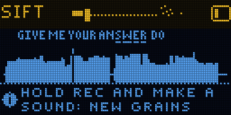
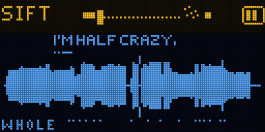

# SIFT

A granular recorder that takes language apart.

SIFT holds 20 seconds of sound and plays it with a head that moves through it. At one end of the knob it plays the
recording whole. Turn it, or tilt the box, and the recording comes apart as speech does when it is torn. First the
tape wears. Then the syllables come loose: one is stammered, the next swapped with its neighbour, one dropped, one
backwards. Then the grains shrink to phonemes, pulled from wherever sounds like this moment. Then dust: a few
milliseconds of sound from anywhere, thrown up and down in pitch, driven and crushed.

It starts with Daisy Bell, sung by MANTRA's voice: "Daisy, Daisy, give me your answer, do! I'm half crazy, all for
the love of you!" Record your own voice, or anything, and it comes apart the same way.

Firmware for the Samplooler Stack (ESP32-S3). Version 0.2, built 2026-10-22, checked in the host simulator
(`tools/sim`, 114 checks) and running on a board (CPU 17 %, 19 % torn to dust with the feedback on). It has not been
played much yet.

> VIDEO: SIFT on a board: Daisy whole, tilted apart, brought back.



## How far it comes apart

A speech recogniser (whisper.cpp, on this computer) listened to 18 seconds at each setting and counted Daisy's 16
words:

| CHAOS | 0 | 10 | 20 | 30 | 40 | 50 | 60 |
| - | - | - | - | - | - | - | - |
| words heard | 15 | 15 | 10 | 11 | 8 | 3 | 0 |

At 20 it heard "Daisy, da-da-daisy". At 50, "crazy, crazy, crazy, crazy". From 60 on there are no words, only voice.

## Playing

1. Switch it on. Daisy Bell plays whole. The screen shows the song as a waveform with the head running through it
   and the words along the top.
2. Turn the knob up slowly. The words go one by one, then the voice turns to dust. The waveform crumbles with it and
   the letters scramble and fall.
3. Tilt the box right: it comes apart at once. Level: whole again. Tilt left from wherever the knob is: it comes back
   together. The knob sets where you are; the tilt throws you there and back.
4. Tip the box towards you: the head slows down, stops half way (a frozen moment), and runs backwards when tipped all
   the way. Away from you it runs up to twice as fast.
5. Hold REC and say something into the mic. Let go. Now your words come apart.
6. DIRT: DRIVE and CRUSH for distortion, FEEDBACK to send the sound back into itself, ROT to write the damage into the
   recording, so it stays torn when you come back. Choosing a Daisy sound again sings Daisy again, whole.



## Controls

| | |
| - | - |
| turn the knob | whole to pieces (CHAOS) |
| tilt right / left | push it apart / bring it back, at once |
| tip towards you / away | the head slower, stopped, backwards / faster |
| hold the knob | the tilt stays where it is (a padlock shows); hold again to let go |
| press the knob | the menu: SOUND, GRAINS, DECOMPOSE, DIRT, ORDER, CHAOS, MAP, TAKE, SPACE, SONG, SYSTEM |
| press the knob twice | the knob turns the volume for a moment |
| REC held | record into it |
| REC tapped | LIVE: it keeps recording until you tap again |
| shake | a burst: it flies apart for a moment |
| stick left / right | shorter / longer grains |
| stick up / down | pitch up / down, up to an octave |

## Sounds

DAISY, DAISY ROT, HAL (Daisy slowing and sinking), TONGUES (syllables stammered), GLOBALALIA (pieces from wherever
sounds alike), SHRED, DUST TO DUST, FREEZE FRAME, BACKWARDS, FEEDBACK, AMEN, AMEN SHRED. Then the first version's
sounds, on the map: MAP, LATTICE, MUSIC BOX, CHORDS, CHOIR, FREEZE, TAPE, STUTTER, MOSAIC, RAIN, GLITCH, SWARM, DUST,
UNDERWATER, STARS. Eight more places for your own, under SOUND > SAVE AS.

A sound with Daisy or the Amen in it brings that recording, unless you have recorded your own: yours stays.

## What it is made of

- **DAISY**: the first two lines of Daisy Bell (Harry Dacre, 1892, public domain), sung by MANTRA's formant voice the
  way the IBM 7094 sang it in 1961. It is synthesized on the board, not a recording.
- **AMEN**: the Amen break's pattern played on WRECK's synthesized kit and printed onto tape, four takes. The famous
  recording is not in the firmware (it is someone else's). To use the real one, record it on the Samplooler, save it
  to a slot, and load that slot here (TAKE > BANK > SLOT).
- **STARTER**: the first version's sounds: plucks, bells, a voice, breaths, clicks.
- Anything you record, and four banks to save it in.

## The map

MODE MAP is the first version of SIFT: every 32 ms piece of the recording is a dot placed by what it sounds like,
the tilt moves a cursor over them, and the knob goes from a tuned pattern on the beat (ORDER) to a swarm (CHAOS). It
is all still there: [docs/MANUAL.md](docs/MANUAL.md) has it.


## With other boards

LINK on: SIFT shares the tempo and the key with BAND, MANTRA, HUFF, WRECK 2, AIR and the Samplooler. In MAP mode its
patterns play on the shared beat, tuned to the shared key.

## MIDI (USB)

| Out | |
| - | - |
| notes | MAP: each pitched grain on the order side |
| CC 1, 2, 3 | the cursor across, the cursor up, how far apart it is now |
| CC 20 and up | every setting, as you change it |
| program change | the sound |

| In | |
| - | - |
| a note held | MAP: the order side plays at that note |
| CC 20 and up, program change | settings, sounds |
| note 60, CC 64 | REC |
| note 64 | hold the tilt |

## Building

ESP-IDF v5.5.1, as for the Samplooler (the core's files are copied in from `core/`, 2026-10-22):

```sh
. ~/esp/esp-idf/export.sh
cd firmware && idf.py build
../tools/flash.sh                         # finds the board by name over USB and flashes only that one
../tools/sim/run.sh                       # the simulator: every check, screens, GIFs and sound in tools/sim/out/
SIFT_WHISPER=0,20,40,60 ../tools/sim/run.sh inst   # also count the words whisper.cpp hears at those settings
```

The full manual is [docs/MANUAL.md](docs/MANUAL.md). All the screens: [images/screens.png](images/screens.png).
