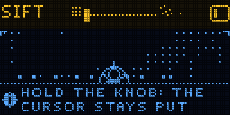
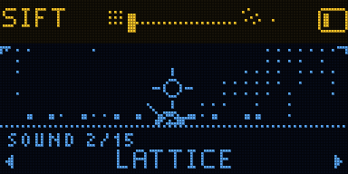

# SIFT

A granular synthesizer and recorder. Chaos on one side, order on the other.

Everything SIFT hears goes into one memory of 20 seconds. It cuts that memory into small pieces of 32 ms and
listens to each one: how loud, how bright, how noisy, and its pitch if it has one. Each piece is a dot on the
screen, placed by what it sounds like: low to high across, clean to noisy up. Tilt the box and a cursor moves over
the dots. The grains come from the dots near the cursor.

One knob runs from ORDER to CHAOS. At ORDER the dots nearest the cursor play as a pattern on the beat, low to
high, each one tuned to the key. At CHAOS grains fly from a wide ring around the cursor at random times, thrown up
and down in pitch, some backwards. In between, the pattern thins out as the swarm thickens. Shake the box and it
goes wild for a moment, then settles.

Firmware for the Samplooler Stack (ESP32-S3). Built on 2026-10-22 and checked in the host simulator (`tools/sim`,
92 checks). It runs on a board (CPU 16 %, the whole 20 s memory fits) but has not been played much yet.

> VIDEO: SIFT on a board, tilting over the grains, ORDER to CHAOS, a shake.



## Playing

1. Switch it on. It starts with its own sounds (plucked strings, bells, a voice, breaths, clicks), already sorted
   on the screen. Tilt the box: the cursor rolls to the low side, and the grains near it play.
2. Turn the knob. Left is ORDER: a tuned pattern on the beat, the dots snap to a grid and the pattern is drawn as
   lines between them. Right is CHAOS: the dots swarm and a wide ring opens around the cursor.
3. Hold REC and make a sound: sing, talk, clap, play something into the mic. Let go. Your sound is now grains on
   the map, next to the old ones. Each take is added (TAKE > TAKES ADD). When the 20 s are full, the oldest go first.
4. Tap REC instead of holding it: it keeps listening (LIVE). Everything you play goes in, and the oldest drops
   out, so the grains are always the last 20 s. Tap again to stop.
5. Shake the box: the grains scatter and it throws itself towards chaos, then settles in a second or two.
6. MAP > CURSOR > VOICE: the mic moves the cursor. Sing or beatbox and the grains that sound most like you play.
   With SING ALONG on, the pitched grains take your note. Use headphones or the line out (SYSTEM > SPEAKER OFF),
   or it hears itself.

At power-on SIFT loads the bank you saved last (TAKE > BANK, SAVE). TAKE > LOAD can also read the Samplooler's
slots: record on the Samplooler, save a slot, flash SIFT, load SLOT 1 to 8, and play it as grains.



## Controls

| | |
| - | - |
| tilt | the cursor: the grains come from the dots near it |
| turn the knob | ORDER to CHAOS (once you have edited another setting in the menu, the knob turns that one) |
| press the knob | the menu: SOUND, GRAINS, ORDER, CHAOS, MAP, TAKE, SPACE, SONG, SYSTEM |
| press the knob twice | the knob turns the volume for a moment |
| hold the knob | the cursor stays where it is (a padlock shows); hold again to let go |
| REC held | record into the grains |
| REC tapped | LIVE: it keeps recording until you tap again |
| shake | scatter: chaos for a moment, and a burst of grains |
| stick left / right | shorter / longer grains |
| stick up / down | pitch up / down, up to an octave |

## The screen

Every dot is a 32 ms piece of what SIFT heard. New ones fall in from the top as they are heard. The cursor is the
small crosshair. The dashed ring is how far the chaos side reaches. The grain playing now lights up where it came
from. The header shows REC, LIVE, LOAD or SAVE on the left, then the knob: a little grid at the ORDER end, a spray
of dots at the CHAOS end. A hollow mark ahead of the knob's mark is the shake. Then a square that blinks on each
beat, an antenna when another board is linked, and the meter.

## Sounds

SIFT, LATTICE, MUSIC BOX, CHORDS, CHOIR, FREEZE, TAPE (the map across is time: a tape you scrub by tilting),
STUTTER, MOSAIC (the cursor on your voice), RAIN, GLITCH, SWARM, DUST, UNDERWATER, STARS. Eight more places for
your own, under SOUND > SAVE AS. The sounds change how the grains play, not what they are made of: your recordings
stay when you change sound.

## With other boards

LINK on: SIFT plays on the flock's beat and in its key. Its tempo and key go out to the others when you change
them (SONG > TEMPO, KEY, SCALE). It plays along with BAND, MANTRA, HUFF, WRECK 2, AIR and the Samplooler.

## MIDI (USB)

| Out | |
| - | - |
| notes | each pitched grain on the order side, at the note it plays |
| CC 1, 2, 3 | the cursor across, the cursor up, how chaotic it is now |
| CC 20 and up | every setting, when you change it |
| program change | the sound |

| In | |
| - | - |
| a note held | the order side plays at that note |
| CC 20 and up, program change | settings, sounds |
| note 60, CC 64 | REC |
| note 64 | hold the cursor |

## Building

ESP-IDF v5.5.1, as for the Samplooler (the core's files are copied in from `core/`, 2026-10-22):

```sh
. ~/esp/esp-idf/export.sh
cd firmware && idf.py build
../tools/flash.sh          # finds the board by name over USB and flashes only that one
../tools/sim/run.sh        # the simulator: every check, screens, GIFs and sound in tools/sim/out/
```

The full manual is [docs/MANUAL.md](docs/MANUAL.md). All the screens: [images/screens.png](images/screens.png).
