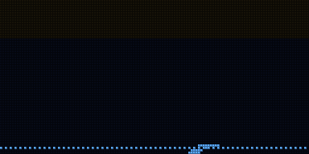
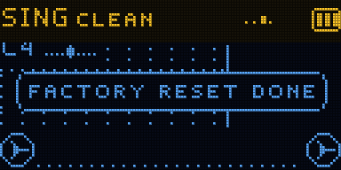

# SING

Your voice, processed and looped. Sing into the mic and it tunes you (a gentle pull, or the hard robot step),
shifts you, makes your throat bigger or smaller, sings harmonies and a choir with you, puts you through a
vocoder on the song's chords, and echoes it. Hold REC to loop what comes out; tilt the box to play the loop
faster, slower or backwards, as the Samplooler does. Next to a [BAND](../band) it plays in the same tempo, key
and chords, and its loops land on the BAND's bars.

Firmware for the Samplooler's ESP32-S3 boards (the Stack, the Mini, the breadboard kit). It runs on a board but has
not been played much yet (see Status).

 

## Playing

1. Sing. Turn the knob for another voice: CLEAN, NATURAL TUNE, HARD TUNE, CHOIR, BARBERSHOP, THIRDS, OCTAVE
   DOWN, ROBOT, VOCODER, TALKBOX, WHISPER, CHIPMUNK, MONSTER, BIG THROAT, SPACE ECHO, CATHEDRAL, SHIMMER, DUB
   VOICE.
2. Hold REC and sing a phrase, then let go: it loops, starting at your first sound (the silence before it and
   REC's clicks are left out). Alone, the first loop sets the tempo (whole bars). Next to a BAND it is whole bars
   at the BAND's tempo; let go early and it records on to the end of the bar.
3. Hold REC again to add to it. Tap REC to stop or start it. To redo it: tap REC, then hold REC; the new take
   replaces the old one.
4. Tip the box forward: the loop plays faster. Tip it back: slower, then backwards. Flat again, it slides back
   onto the beat. The pitch stays where you sang it, so it stays in key (LOOP > SPEED MODE: OCTAVES moves it by
   octaves only, TAPE lets the pitch go with the speed, as the Samplooler does).
5. Roll it left to throw your voice into the echo; roll it right to stutter (a beat, then shorter slices the
   further you roll).
6. The stick, if the board has one: left and right move the throat, up and down bend the pitch.

The screen shows the note you sing and how sharp or flat you are, your pitch as you sing it (dots) and as it
comes out tuned (a line) over the notes it can land on, a head for every voice singing, the vocoder's bands,
and the loop on the Samplooler's tape reels.

## With a BAND

Switch both on. LINK is on by default, in group 1; within a second they find each other ("LINKED: BAND") and the
header shows two little boards flashing on the beat. The radio is ESP-NOW, Espressif's own protocol on the
Wi-Fi radio: no router, no pairing, a few milliseconds per packet.

- The BAND keeps the time. SING follows its tempo, key, scale and chords, and the BAND follows SING's when you
  change them here.
- Until there is a loop, either board can change the tempo. Once there is one it stays until every loop is
  cleared.
- Every loop on either board is whole bars and starts on the same beat. SING's can be a multiple of the BAND's
  (sing four bars over a one-bar drum loop).
- When the BAND's bass leans to another chord, the vocoder and the harmonies follow it.
- In the simulator the two boards' beats stay within half a millisecond of each other, with their crystals 25
  parts per million apart.
- LINK > GROUP keeps two pairs in one room apart. LINK > RANGE lowers the radio's power; NEAR is enough on one
  table.

## Controls

| | |
| - | - |
| turn the knob | the next voice |
| press the knob | the menu |
| press the knob twice | the knob turns the volume, until it rests 3 s or you press it again |
| hold the knob | leave the menu; outside it, hold the tilt where it is |
| hold REC | record (or add to) the loop |
| tap REC | stop / start the loop |
| tap REC, then hold REC | a new take in place of the old one |
| tip forward / back | the loop faster / slower and backwards (LOOP > TILT: or the pitch, or the throat) |
| roll left / right | echo throw / stutter |
| stick | throat (left, right), pitch bend (up, down) |

## Sounds

18 voices (above). Each sets the tuning, the harmony, the choir, the vocoder, the echo and the reverb; the key,
the tempo, the loop and the link stay as they are. SAVE AS keeps eight of your own.

## MIDI (USB)

Notes held on a keyboard are the chord: the vocoder plays them, and CHORD harmonies and TUNE TO: CHORD use them.
The sustain pedal (CC 64) is REC. SING sends the note it sings, tuned. Every setting is on a CC; program change
picks a voice. The list is in [docs/MANUAL.md](docs/MANUAL.md).

## The sound

- The plain voice goes straight through. The tuned voice, the harmonies and the choir come 16 ms later (longer
  for voices below about 115 Hz, up to 40 ms): they are made of grains one or two periods of your voice long.
- The speaker sits next to the mic. INPUT > HOWL GUARD notches a tone that rings and keeps growing, and turns the
  input down if it still grows. INPUT > MONITOR turns the live voice down on the speaker without touching what
  is looped. Headphones or the line out are better for singing.

## Build

ESP-IDF v5.5.1:

```sh
. ~/esp/esp-idf/export.sh
cd firmware && idf.py build
../tools/flash.sh          # finds the board by name, never touches a TWOFOLD
```

`tools/sim/run.sh` runs the simulator and writes screens, animations and sound to `tools/sim/out/`.
`tools/dsp/run_voice.sh` and `tools/dsp/run_fx.sh` measure the voice engine and the vocoder and effects on their
own (WAVs to listen to in `tools/dsp/out-*`).

## Status

Runs on a board (2026-10-15): 25 to 35 % of the CPU with the vocoder off (about 20 % more with it on), no dropouts.
Not played much yet, and the link has not met a BAND on real radio yet. In the simulator: 71 checks of the whole
instrument, 58 of the voice engine (pitch within half a cent from 75 to 1180 Hz, the hard tune lands within 7 ms), 49
of the vocoder and effects.
