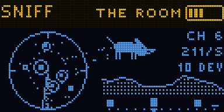
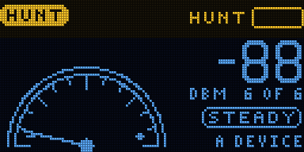
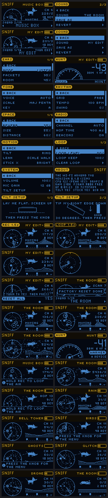

# SNIFF

The Wi-Fi around you, as sound. Firmware for the Samplooler boards (the Stack, the Mini, the breadboard
kit: ESP32-S3).

Every device near you that uses Wi-Fi gets its own note, and each time it sends something, the note
plays. Routers ring like bells, phones looking for networks chirp, the tiny replies tick. A soft chord
follows the room itself: when someone walks past the router, it swells. A microwave oven or a crowded
band turns into crackle and thunder. HUNT turns it into a finder: it beeps faster as you walk towards a
device.

**Status:** not yet run on hardware. Everything here was checked in the host simulator (`tools/sim`,
83 checks), which makes up a flat full of devices, a person walking about and a microwave oven.

 

## Playing

1. Switch it on. For a few seconds it listens to every channel (SCAN on the screen), then stays on
   the busiest one and plays what it hears.
2. Turn the knob for another sound. The first one, THE ROOM, has a bit of everything.
3. Walk past your router and listen: the chord moves (the dog's ears go up, MOVING on the screen).
4. Turn to HUNT and walk around: the needle and the beeping tell you whether you are getting closer.
   Flick the joystick left or right to hunt another device.
5. Hold REC to loop what you hear. Hold it again to add to the loop, tap it to stop or start the loop.

| Control | Does |
| - | - |
| turn the knob | next or previous sound |
| press the knob | the menu (press to go in, press again to come back; hold to leave) |
| hold the knob | hold the tilt where it is; again to let go |
| REC | hold: record a loop or add to it; tap: stop / play the loop |
| tilt, bottom edge down | notes ring longer |
| lean left / right | walk the notes up and down the scale |
| joystick up / down | up: hear only what is near; down: hear everything |
| joystick left / right | darker / brighter; in HUNT, the next device |

What tilt, lean and the joystick do can be changed under MOTION in the menu.

## The screen

The radar on the left is the room: each dot a device, nearer the middle the stronger its signal, a
square for a router. A ring goes out when a device sends something that sounds. The dog sniffs the
air and catches each one. On the right: the channel, frames a second, how many devices; under them,
the room's radio shape (it ripples when someone moves) and the 13 channels, busiest highest.

## Sounds

| | |
| - | - |
| THE ROOM | everything at once: plucks, bells, chirps, ticks, the room's chord |
| MUSIC BOX | kalimba notes snapped to a 1/16 grid at 96 BPM, C major pentatonic |
| RAIN | every frame a raindrop |
| BELL TOWER | slow bells in a pelog scale, a big hall |
| BIRDS | every device a bird |
| GHOSTS | only the room's chord: hear people move |
| STORM | only the interference |
| HUNT | find one device by ear |
| MORSE | beeps as long as the frames |
| DRONE | long bells, low and wide |
| GLITCH | clicks of static on a fast grid, with echoes |
| KALIMBA | A minor pentatonic tines |
| SCANNER | a police scanner's hiss and ticks |
| CLOCKWORK | plucks on a triplet grid |

Change anything in the menu and the sound becomes MY EDIT. SOUND > SAVE AS keeps up to eight of your
own. [docs/MANUAL.md](docs/MANUAL.md) explains every setting.

## Privacy

SNIFF only listens: it never joins a network or sends anything. Of each frame it keeps the kind, the
length, the signal strength, the channel and a number made from the sender's address mixed with a
random value that changes every time it starts. No address, network name or content is kept, shown or
sent anywhere.

## MIDI

Over USB. Each note that sounds goes out as a MIDI note on the MIDI channel (SYSTEM > MIDI CH),
louder for nearer devices. CC 3 is the frame rate, CC 4 how much the room moves, CC 5 the storm, CC 6
how near the HUNT target is. CC 12/13 the tilt, 14/15 the joystick. Every setting is on CC 20
onwards, both ways (the list is in the manual). A note in sets the key; note 60 or the sustain pedal (CC 64) is REC. Program change picks a sound.

## Building

ESP-IDF v5.5.1, as for the Samplooler:

```sh
. ~/esp/esp-idf/export.sh
cd firmware && idf.py build
../tools/flash.sh          # finds the board by name over USB and flashes only that one
../tools/sim/run.sh        # the simulator: screens, animations and sound in tools/sim/out/
```


